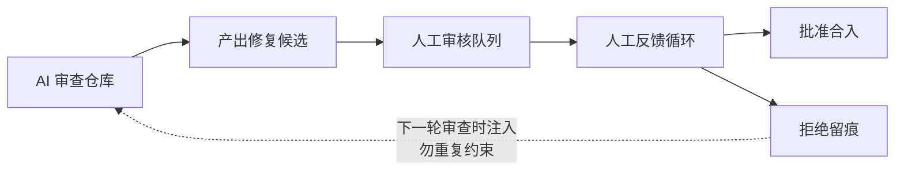
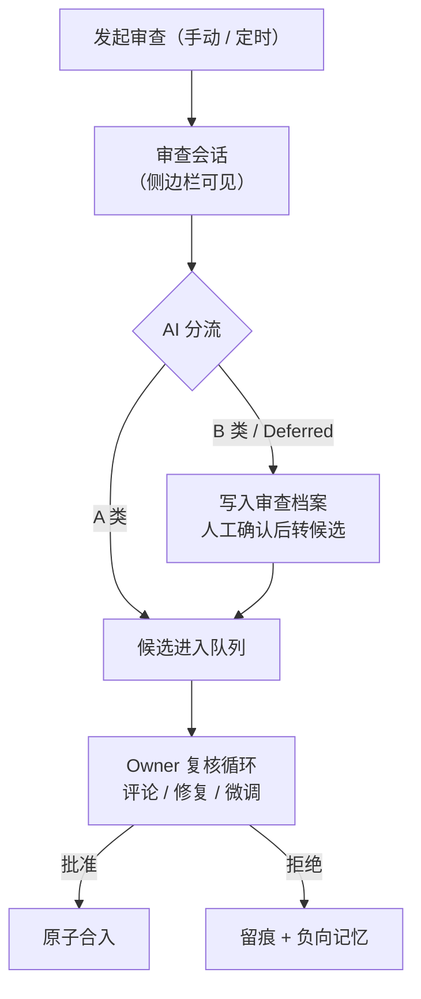
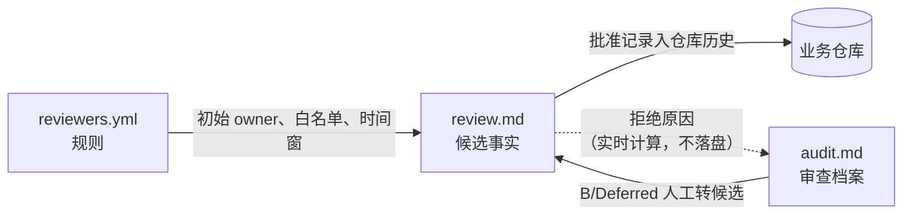
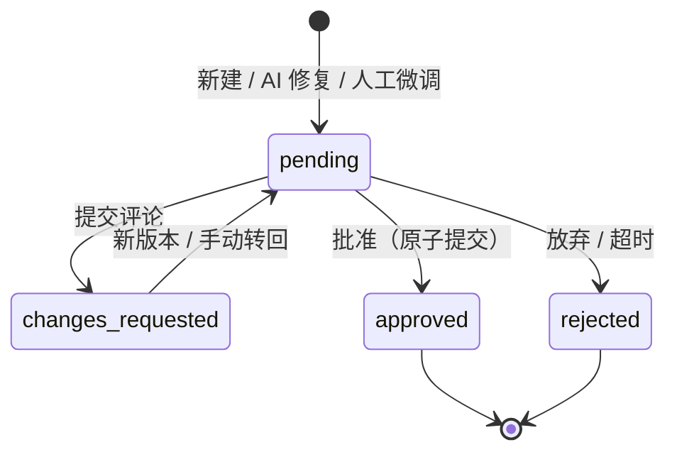

# dsh-code-review · 设计说明与使用指南

> 一份文档，三种读法：**新协作者**读 §2、§4 理解设计为什么是这样；**用户**读 §3 上手日常操作；**制作人**读 §1、§5、§6 了解定位、边界与术语。术语在首次出现处随文解释，速查见 §6。
> 本文描述目标设计（完整数据契约见 `docs/plans/2026-11-03-review-workflow-data-design.md`）；今天哪些能用、哪些还在落地，见 §1 末尾「现状」。

## 1. 这是什么

**dsh-code-review** 是 DeepSeek Harness（DSH）桌面端的代码评审插件。它做的事一句话：**在代码仓库里为 AI 产出的修复维护一个人工审核队列**——AI 找问题、写补丁；人集中看差异、提意见、做决定；批准时插件真实重跑验证，再原子合入（原子提交＝多个变更打包为一次提交，要么全部生效、要么全部不发生）。



它解决三个问题：

1. **AI 改代码容易、人兜底难**：AI 大批量产出修复，人需要一处集中看差异、提意见、跑门禁（门禁＝批准前必须实际执行且全部通过的命令集合）、做决定。
2. **AI 的验证叙述不可信**：AI 说"测试通过"不算数。插件在批准时以当前用户权限真实重跑全部门禁，记录每条命令的真实结果。
3. **审查发现无法延续**：每轮审查不应从零开始。审查档案给每个问题一个跨轮稳定的身份（finding），下一轮审查自动复查未闭合的问题；被拒方案沉淀为负向记忆（从被拒记录派生的"勿重复"约束），在配置的时间窗口内阻止**完全相同**的方案再次进入队列——轻量精确匹配，不是语义级去重。

一句话定位：不建后端、不复制评审数据库，仓库本身承载全部评审数据。`review.md` 加补丁文件是唯一的共享事实，评审历史因此随代码一起版本化、同步和审计。

**现状**（给制作人）：核心回路——审查 → 生成候选 → 评论 → AI 修复 → 门禁 → 批准/拒绝——已在本机真实仓库完整走通（Git 与 SVN 均验证）。仍在落地的契约能力：B/Deferred 转候选、人工微调、Rebase、定时审查、负向记忆阻止与人工重开；逐项进度见 `README.md`「已知边界」。

## 2. 设计哲学

七条理念，每条一句话，各自直接决定了数据结构的样子：

| 理念 | 一句话 |
| --- | --- |
| 仓库是唯一事实源 | 评审数据随代码走，无后端，任何 Git 工具都能读 |
| 发现与修复分账 | 审查档案管问题发现与跨轮追踪，候选管修复审核 |
| AI 生产、机器复算、人类拍板 | 只有真实重跑的证据和人的批准才算数 |
| 能计算的不持久化，能放进现有文件的不新增文件 | 队列、问题列表、负向记忆实时计算，删掉缓存即可复原 |
| 共享提交成功才算完成 | 进入仓库提交才算事实，本地写文件不算数 |
| 一切留痕 | 批准、拒绝、人工确认全部永久可审计 |
| 保守边界 | 只 commit 不 push；owner 是约定不是鉴权 |

## 3. 使用流程

### 3.1 第一次使用

1. 安装并启用插件（`npm install && npm run build`，再用 DSH Plugin Manager 安装本目录，详见 README「安装」）。
2. 打开会话顶部的「评审」标签页，完成首次设置：评审仓库（自动取当前目录）和你的 owner 名（默认取 `git config user.name`）。
3. （可选）在 `.ai-review/reviewers.yml` 配置目录→owner 路由与门禁白名单；没有配置也能用，候选默认归当前操作者。
4. 点「审查仓库」发起一轮审查（手动）；定时审查（规划中）将按计划自动复查。
5. 审查会话结束后，候选出现在队列中；点开详情即可开始复核。

### 3.2 日常循环

审查可手动发起，也可定时触发（规划中）；无论哪种方式，每一轮都会自动复查之前未闭合的问题。AI 把发现分为三类：**A 类**（无疑问的修复）直接生成候选进入队列；**B 类**（需要人拍板）和 **Deferred**（等前序候选合入）写入审查档案，等人工确认后再转成候选。候选由 **Owner**（当前唯一有权操作它的人）复核，循环到满意后批准合入，或拒绝归档。



三类分流的标准：

| 类别 | 判定 | 去向 |
| --- | --- | --- |
| A 类 | 无疑问的本质修复、低风险明显精简 | 直接改码、跑门禁、生成候选 |
| B 类 | 业务取舍、跨模块大改、协议变更、无法本地验证 | 写入审查档案（`audit.md`），等人工决策 |
| Deferred | 依赖前序候选先合入 | 写入审查档案并标记依赖，前置满足后才可转换 |

**复核循环是日常主路径**，详情页为此提供：完整与增量差异（Git 用临时 worktree 真实重建，跨版本先三方合并）、行内评论与逐条处理状态（未处理/部分/已处理）、人工判断项清单（必须由人确认的决策点）、验证证据。总体意见提交后可一键让 AI 按全部未解决意见生成下一版；AI 修复失败不丢状态——候选停在"等待修复"，可重试或手动转回。

### 3.3 操作一览

已实现的能力直接可用；标注「规划中」的属于设计契约、尚未落地。

| 操作 | 谁可以做 | 发生什么 |
| --- | --- | --- |
| 发起审查 | 任何人 | 新建审查会话；结束后只提交评审数据，不碰业务代码 |
| 浏览队列 / 详情 | 任何人（只读） | 按状态、owner、tag、目录筛选；看差异、人工判断项、验证证据 |
| 行内 / 总体评论 | Owner | 提交意见；可一键让 AI 按全部未解决意见生成下一版 |
| 接管 | 任何人 | 成为新 Owner；原 Owner 的旧页面再操作会提示已过期、需刷新 |
| 批准 | 仅 Owner | 核心三步（工作区干净 → 应用补丁 → 重跑门禁）外加人工判断项逐项确认与并发保护，然后一次原子提交；另有一次仅回填提交哈希的轻量提交，见 §4.3。基线冲突时先 Rebase，不允许直接批准 |
| 拒绝 | Owner | 必填原因；补丁清理，`review.md` 永久保留 |
| 人工微调（规划中） | Owner | 在隔离工作区直接改代码，生成新版本（作者标记为 human） |
| Rebase（规划中） | Owner | 基线落后或冲突时，在最新基线上重做补丁、重跑门禁 |
| 重开被拒方案（规划中） | Owner | 填写重开原因（必填）后，可越过负向记忆窗口重新生成；全程留痕可审计 |

超时归档（规划中）：候选超过配置天数无人处理时，由定时任务或显式「归档过期候选」操作自动废弃，记录为系统身份 `system:stale`。

## 4. 数据结构设计与理由

### 4.1 目录布局

```text
.ai-review/
  reviewers.yml                     # 配置：owner 路由、门禁白名单、时间窗
  audits/<开始时间-范围>/audit.md    # 每轮审查一份档案（目录名 = 时间戳 + 审查范围）
  <YYYY-MM>/<日期-模块-短名>/        # 每个候选一个目录，创建后不改名、不移动
    review.md                       # 评审事实：状态、版本、门禁、意见、批准/拒绝记录
    001.patch … NNN.patch           # 每个版本一份全量补丁；批准或拒绝（合称归档）后删除
```

### 4.2 三份数据的职责



- **`reviewers.yml`**：目录/tag → 初始 owner 路由、门禁白名单、超时天数、负向记忆窗口。纯配置，无状态。
- **`audit.md`**：每轮审查的档案。核心是 finding——跨轮稳定的问题身份：下一轮审查覆盖同一范围时自动复查它，确认已消失记 `resolved`，仍存在记 `pending`，未复查的保持上次观察（历史档案从不重写）。查"当前还有哪些问题"时，取每个 finding 的最新观察，再结合其转成候选的真实状态（已批准＝闭合，被拒＝重新开启）。
- **`review.md`**：候选的全部审核历史。YAML Frontmatter 供机器读写，Markdown 正文供人阅读，两者以 Frontmatter 为权威。

### 4.3 关键设计决策与理由

| 决策 | 理由 |
| --- | --- |
| Markdown + YAML Frontmatter，不用数据库 | 人可以直接阅读和 diff，无需额外工具 |
| 共享状态只有 4 值（§4.4） | 状态只记审核结论，不掺执行过程 |
| 每版全量补丁，禁止堆叠补丁 | 任何版本可独立重建与验证，候选之间互不阻塞 |
| `schema_version` 保持 1 | 扩展只走可选字段与新增枚举值；破坏性变更才升版本 |
| 拒绝后 `review.md` 永久保留 | 负向记忆的事实源 |
| 无共享索引 | 实时计算，删缓存即可复原，不存在索引与事实不一致 |

**批准为什么是两次提交**：第一个原子提交装业务代码与评审记录——但提交哈希写不进自身；因此第二个仅 `.ai-review` 的提交把哈希回填进 `review.md` 的 `commit_revision` 字段，CI 按路径跳过这类提交即可。

**负向记忆怎么工作**：从被拒候选提取「模块 + 文件 + 类型 + 标题 + 拒绝原因」，窗口时长在 `reviewers.yml` 配置。窗口内完全相同的方案被插件阻止；相似但不完全相同的方案靠下一轮审查时的提示词注入由 AI 与人把关——所以它挡得住复读机，挡不住换写法。

### 4.4 候选状态机



`approved` 与 `rejected` 是终态：不再接受评论、修复或状态修正——历史不可篡改，后续变化一定是新的候选。

## 5. 安全与边界（给制作人）

- **门禁是最危险的攻击面**：`gate_checks` 以你的用户身份执行任意 shell 命令，拥有你本机的全部权限（可联网、可删文件）。白名单只降低确认成本，不是安全机制；UI 明文展示全部命令。请只批准可信来源的候选。插件自身除了批准路径执行 `gate_checks` 中声明的命令外，不执行其他命令。
- **复算不是万能（使用建议）**：真实重跑挡不住"补丁改写门禁所依赖的测试"这类绕过——门禁通过不等于补丁安全，人工复核仍是最终防线。门禁失败或补丁冲突时，插件自动还原你的业务工作区。
- **路径与数据卫生**：所有路径字段强制校验为仓库内相对路径，禁止绝对路径、`..` 与符号链接逃逸；禁止在评审数据中写入密钥、Token 等凭证，验证证据只保留摘要。
- **owner 不是鉴权**：本地环境下，任何能写仓库的人都能改写评审记录；试点依赖小团队互信，这是试点前提而非缺陷。真正的权限控制需要仓库/服务端能力，已列为试点前评估项。
- **只 commit 不 push**：插件自身不访问网络（门禁命令除外，见上）。
- **适用环境**：Git 完整支持；SVN 支持提交、门禁与批准，但差异显示精度降为按代码块（而非按行）。
- **一期明确不做**：批量操作、外部 Ticket 系统的自动抓取与深度集成（候选可记录外部单号，但不依赖它）、真实鉴权、独立后端。

## 6. 术语速查

| 术语 | 含义 |
| --- | --- |
| 候选 / candidate | 一个可独立审核与合入的修复包：`review.md` + 全量补丁 |
| 审查 / audit | 一次针对某范围的仓库审查，产出一份审查档案（`audit.md`） |
| finding | 审查发现的问题身份，跨轮稳定；下一轮审查自动复查未闭合的 finding |
| 门禁 / gate | 批准前必须实际执行且全部通过的命令集合 |
| 原子提交 | 多个变更打包为一次提交：要么全部生效，要么全部不发生 |
| 人工判断项 | AI 无法自证、必须由人确认的决策点；批准时逐项确认或标记知悉 |
| Owner | 当前唯一有权操作该候选的人；本地协作约定，不是鉴权 |
| 负向记忆 | 从被拒候选提取的"勿重复"约束；窗口时长在 `reviewers.yml` 配置，窗口内只阻止完全相同的方案 |
| 乐观锁 | 每次操作携带期望版本与 owner；他人先改过后，你的操作会被提示过期、需刷新 |
| A / B / Deferred | 直接生成候选 / 需人工确认 / 等前置合入后处理（判定见 §3.2 表） |
