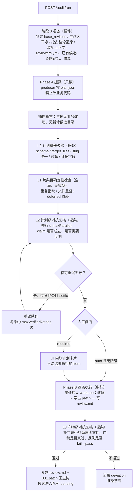
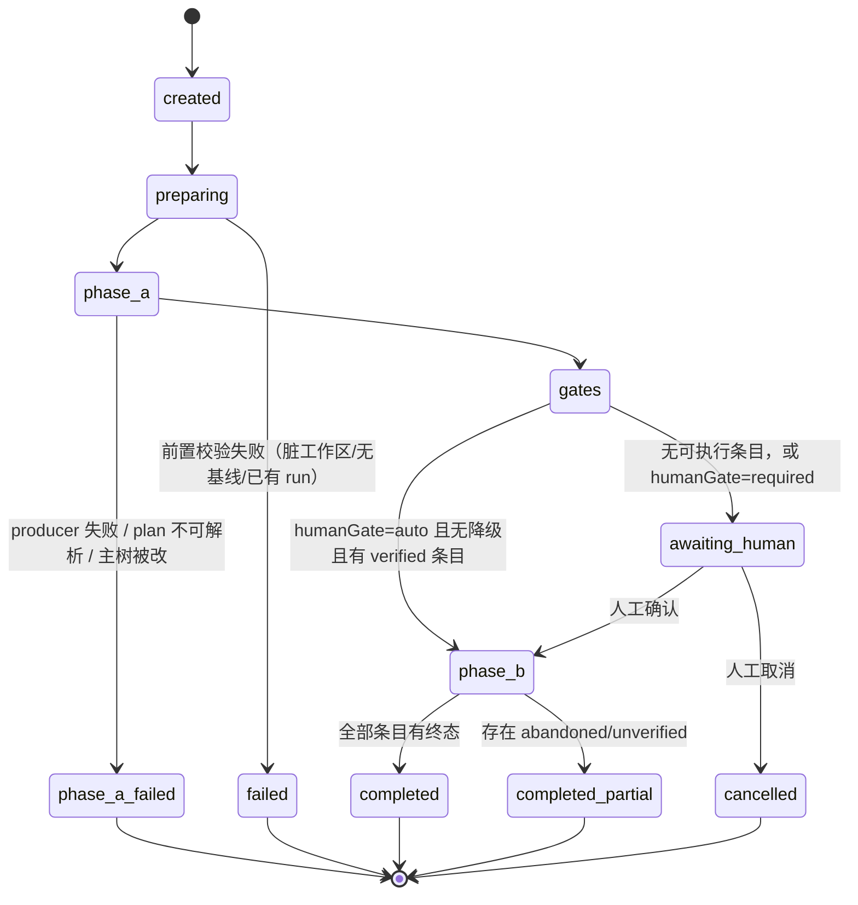
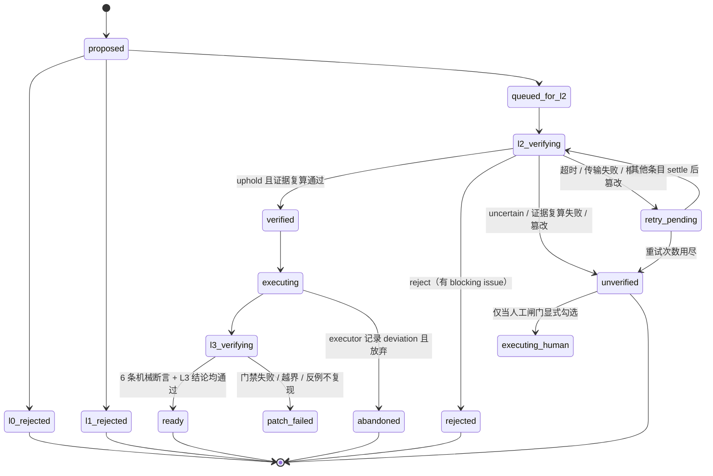

# 仓库审查两阶段化设计（Phase A 提案 / Phase B 执行）+ 逐条对抗复核

| 项 | 内容 |
|---|---|
| 状态 | **未落地的设计提案（归档）**：两阶段审查（生产者/对抗者）未实现；现行 `README.md` 走的是单会话直接产出候选。文中"P0/B0/B1 已实现"指的是 2026-11-03 后被 `reset` 掉的一条工作线，当前 `master` 不含对应代码 |
| 版本 | v1.1（2026-11-06 归档：仅补充状态说明与说明文字，设计内容未改） |
| 日期 | 2026-11-03 |
| 适用 | `dsh-code-review` 0.3.0（历史语境） |
| 关联 | `dsh_web.md`（原始设计）、`docs/dsh-platform-notes.md`（平台核查）、`README.md`（as-built） |
| 读者 | 实现者、评审者；验收按 §16 的验收标准执行 |

**变更记录**

| 版本 | 日期 | 变更 |
|---|---|---|
| v0.1 | 2026-11-03 | 首版：两阶段 + 逐条对抗复核 |
| v0.5 | 2026-11-03 | 决策 D1–D4 定稿（SessionAdversary 不做、单目标、无 never 档、run 目录提交） |
| v0.7 | 2026-11-03 | B0 三层探针完成，新增 §8.1.1 调用契约；B0 由"可行性探针"改为"落地自检" |
| v0.9 | 2026-11-03 | 决策 D5（parent 锚点混合）落地；**引入 L3 产物级对抗**；新增 §2 前置依赖、附录 A run.json、候选命名与 owner 解析（D7）；统一术语与编号；补齐配置/API/测试矩阵 |
| v1.0 | 2026-11-03 | **P0 与 B0 完成**；§8.2 换成真机实测契约（6 条硬约束 + 跑通的调用形状）；同步 docs/dsh-platform-notes.md §3/§8 |
| v1.1 | 2026-11-03 | **B1 完成**：`src/host/worktree.ts`（`withWorktree`/`fingerprint`/`pruneAll`）；§8.5/§9/§16 标注实现状态；测试 80 项 |

---

## 目录

- [0. 决策摘要](#0-决策摘要)
- [1. 目标与非目标](#1-目标与非目标)
- [2. 前置依赖](#2-前置依赖)
- [3. 术语与不变式](#3-术语与不变式)
- [4. 总体流程](#4-总体流程)
- [5. 复核分级与证据契约](#5-复核分级与证据契约)
- [6. 产物契约](#6-产物契约)
- [7. 状态机](#7-状态机)
- [8. 对抗复核执行器](#8-对抗复核执行器)
- [9. 隔离与 worktree](#9-隔离与-worktree)
- [10. 插件改造清单](#10-插件改造清单)
- [11. 配置契约](#11-配置契约)
- [12. API 契约](#12-api-契约)
- [13. 与既有数据契约的衔接](#13-与既有数据契约的衔接)
- [14. 测试策略](#14-测试策略)
- [15. 失败与降级矩阵](#15-失败与降级矩阵)
- [16. 落地顺序与验收](#16-落地顺序与验收)
- [17. 风险与已决/未决](#17-风险与已决未决)
- [18. 与 dsh_web.md 的关系](#18-与-dsh_webmd-的关系)
- [附录 A：run.json](#附录-arunjson)

---

## 0. 决策摘要

| # | 决策 | 结论 |
|---|---|---|
| D1 | `SessionAdversary` 是否实现 | **不做**，`fallback='none'`；接口预留 `kind:'session'` |
| D2 | Phase A 是否支持多目标范围 | **单 include**；`scope` 按对象形状预留 `{include[], exclude[]}` |
| D3 | `humanGate` 是否提供 `never` | **不提供**；`auto` 只自动放行 `verified` |
| D4 | run 目录是否入库 | **入库**，保留最近 20 轮 / 90 天 |
| D5 | L2/L3 的 parent Agent 锚点 | **混合**：默认 `launch`，可配 `dedicated` |
| D6 | 是否强依赖未合入的候选 | **是**，三个候选必须先行合入（见 §2.1） |
| D7 | 候选目录名与 owner 的来源 | `plan.json` 携带 `slug` 与 `owner`，插件校验（见 §6.2） |

---

## 1. 目标与非目标

**目标**

1. 把"一条巨型提示词、一口气改代码"拆成 **Phase A（只读提案）→ 闸门 → Phase B（逐条执行）**。
2. Phase A 之后插入**二次确认**：L0 机器校验 → L1 跨条目确定性检查 → L2 计划级对抗复核 → 人工闸门（可配置）→ Phase B → L3 产物级对抗复核。
3. 对抗复核**一条一个独立上下文**，绝不在同一个上下文里批量复核多条。
4. 裁决权收归插件：模型只产出**可复算的证据**，插件执行复算并写裁决。
5. 执行与验证在 **git worktree** 中完成；主工作区在整轮运行期间保持干净。

**非目标（本轮不做）**

- 不改 `review.md` / `NNN.patch` 的既有语义，不改 `store` / `frontmatter` 解析器。
- 不改批准流程（`approval.ts` 仍在主工作区执行；改用 worktree 是后续独立任务）。
- 不做真正的鉴权（保持本地单用户模型）。
- 不实现一键 Rebase、人工微调、`commit_message` 提交、`rejection` 负向记忆（这些各有独立任务）。

---

## 2. 前置依赖

### 2.1 必须先合入的候选（硬依赖）

本设计有 **3 处**直接依赖仓库里**尚未合入**的候选补丁。它们目前全是 `status: pending`，不在 `src/` 里：

| 依赖的候选 | 本设计用在哪 | 不先合入的后果 |
|---|---|---|
| `.ai-review/2026-11/20261102-api-workspace-job-mutex/` | 整轮 run 期间独占工作区（`ensureNoWorkspaceJobRunning`） | 现有代码只有 `ensureNoAuditRunning`（`src/host/api.ts:864`，只拦 `audit`）；**Phase B 与用户点「批准」会同时改工作树** —— 正是已删除的六视角评审报告（`.review/runtime.md`）的 P0 |
| `.ai-review/2026-11/20261102-patch-hunk-boundary/` | L1 的 hunk 区间重叠计算、L3 的"补丁只动声明文件" | 现有 `parsePatch` 会把 hunk 内以 `-- ` / `++ ` 开头的行当成文件头 → **重叠判定与越界判定都会错** |
| `.ai-review/2026-11/20261102-vcs-atomic-commit-pathspec/` | 把 worktree 产物复制回主树后的原子提交 | 现有 `atomicCommit` 的 `git commit` 无 pathspec → 会顺带提交主树里其他人已 staged 的改动 |

**行动**：开工前先批这 3 个（它们都是纯 bugfix、门禁可自证），把 `main` 推到含修复的基线。**这既是技术前置，也是验证这套流程本身的机会**——用现有队列审这 3 个候选，正好走一遍"批准"路径。

### 2.2 平台能力依赖

均已在真机核查（详见 `docs/dsh-platform-notes.md`）：

| 依赖 | 级别 | 说明 |
|---|---|---|
| `ctx.get('subagents')` + provider `spawn` | [装配] + [运行时] | `dsh-base` 层就挂载；`start(name, request)` 返回 receipt |
| `ctx.get('agents').get(sessionId)` 返回活体 Agent | [源码] | **spawn 的硬约束**：`agents.get(parent.id) === parent`，否则 `UNAUTHORIZED` |
| `delivery:'caller'` 抑制结算通知 | [源码] | 不传会把子代理完成消息插进用户对话 |
| 绝对 `cwd` 透传 | [源码] | worktree 隔离的前提 |
| `agentOptions`（provider/model/reasoningEffort） | [源码] | 换模型做对抗 |
| `maxActiveSubagents=8`、`maxDepth` 默认 1 | [装配] + 文档 | 并发上限与递归预算 |

**未验证项**（B0 必须确认，见 §16）：`agents.get` 在真机对发起会话能否拿到活体 agent；`delivery:'caller'` 是否真的不插消息；`agentPreset` 是否可选只读预设。

---

## 3. 术语与不变式

| 术语 | 含义 |
|---|---|
| run | 一次两阶段审查运行，`runId` 形如 `20261103-104500-src-host` |
| item | 一条 A 类提案，对应未来一个候选目录 |
| plan | Phase A 产物 `plan.json`，含 `items[] / b_class[] / deferred[]` |
| producer | Phase A 的执行者（模型） |
| verifier | L2 / L3 的对抗复核者（模型，逐条） |
| executor | Phase B 的执行者（模型，逐条） |
| verdict | 对抗复核结论：`uphold` / `reject` / `uncertain` |
| evidence | 可被插件**重新执行**的证据（反例退出码、搜索命中数、门禁结果） |
| deviation | Phase B 中"计划不成立"的记录，写入 `deviations.json` |
| anchor session | 提供 parent Agent 的会话（`launch` 或 `dedicated`） |

**不变式（验收按此逐条检查）**

| # | 不变式 |
|---|---|
| I1 | **写域分离**：`plan.json` 只由 producer 写；`verdicts/*.json` + `evidence/*` 只由 verifier 写；`deviations.json` 只由 executor 写；`gate-*.json`、`run.json`、`report.md` 只由插件写。越界即 run 失败 |
| I2 | **一条一上下文**：L2/L3 每次模型调用只接收一条 item（+ 基线 + 该条产物）；禁止多条进同一上下文 |
| I3 | **证据可复算**：verdict 的证据必须能被插件重新执行并判定真假；纯叙述无效 |
| I4 | **主树只读**：Phase A / L2 / L3 期间主工作区不得出现业务代码改动；Phase B 的改动只发生在 worktree 内 |
| I5 | **基线独立**：每条 item 的补丁相对同一 `base_revision` 生成且互不依赖 |
| I6 | **追加式产物**：run 目录只追加不覆盖；重试写 `<item>.retry-N.json` |
| I7 | **降级不静默**：任何降级写进 `run.json.degradations[]`，并在 `report.md` 与候选徽章上显示 |

---

## 4. 总体流程



## 5. 复核分级与证据契约

### 5.1 四级划分

| 级别 | 时机 | 执行者 | 输入 | 判据 | 并发 |
|---|---|---|---|---|---|
| **L0** 计划机器校验 | Phase A 后 | 插件（纯代码） | `plan.json` | schema / 文件存在 / slug 唯一 / 预算 / 证据字段齐全 | 逐条，廉价 |
| **L1** 跨条目一致性 | L0 后 | 插件（纯代码） | 全部 items + 已有候选清单 | 重复指纹、`target_files` 交集、deferred 依赖 | 全局，N≤6 |
| **L2** 计划级对抗 | L1 后 | 模型（逐条） | 单条 item + 基线 + 只读仓库 | claim 是否成立、能否给出反例 | ≤ `maxParallel` |
| **L3** 产物级对抗 | Phase B 后 | 模型（逐条）+ 插件 6 条机械断言 | 单条 item + 该条 worktree + 补丁 | 补丁是否越界、门禁是否真过、反例 fail→pass | ≤ `maxParallel` |
| 人工闸门 | L2 后 | 人 | 计划摘要 + L0/L1/L2 结果 | "这批值不值得花执行成本" | — |

**分界线**：需要推理的（"这个 claim 站得住吗"）逐条给模型；纯机械的（"两条改同一段代码吗""补丁动了几行"）绝不交给模型。

### 5.2 L1 具体规则

1. **重复指纹**：`module + sorted(target_files) + audit_type` 相同 ⇒ 与 plan 内其他 item 或**已存在候选**重复 → `l1_rejected/already_exists`。
2. **目录名冲突**：两条 item 的 `slug`（或设备生成的目录名）相同，或与 `.ai-review/<month>/` 下已有目录同名 → `l1_rejected/name_collision`。
3. **文件重叠**：`target_files` 交集非空 → 打标 `overlap` 进入人工闸门摘要（不拒绝，因为允许"同函数耦合合并"）。
4. **deferred 依赖**：`depends_on: item-00X` 必须指向本轮存在且 `verified` 的 item；`external:*` 只记录不判定。
5. **hunk 重叠**：Phase B 之后回填——两条候选补丁在同一文件且行区间相交 → `merge_conflict_risk`（依赖 §2.1 的 `patch-hunk-boundary`）。

### 5.3 证据契约（按 `audit_type`）

| audit_type | 必证形式 | 插件复算方式 | 缺证据时 |
|---|---|---|---|
| `bugfix` | 反例脚本：基线上非零退出、打补丁后零退出 | worktree 内跑两次命令，比退出码 | verdict 无效 → `unverified` |
| `delete` / `shrink` | 符号搜索 `expected_matches: 0` | 用相同 pattern/scope 重跑搜索 | verdict 无效 |
| `reuse` / `merge` | 调用点清单 + 既有门禁覆盖行为不变 | 重跑 `gate_checks` | 降级为 `needs_human` 必填项 |
| `split` | 既有测试全绿 + 导出符号无变化 | 重跑门禁 + 比对导出符号 | verdict 无效 |
| `perf` | before/after 基准命令与数字 | 跑两次取数，要求改善 ≥ 声明阈值 | 降级为 B 类 |

`symbol_search` 结构：

```jsonc
{ "pattern": "LegacyDecode", "scope": ["src"], "expected_matches": 0,
  "command": "rg -n --no-heading LegacyDecode src" }
```

**关键**：插件不理解证据语义，只机械复算（跑命令 → 比退出码/命中数）。这是 I3 的落地，也是把裁决权从模型手里拿回的手段。

### 5.4 L3 的 6 条机械断言（插件执行，不依赖模型）

1. 补丁不含 `.ai-review/**`；
2. 补丁触碰的文件 ⊆ item 的 `target_files`（越界 → `scope_creep`）；
3. 在干净 worktree 上 `git apply --check` 通过；
4. 插件亲自执行 `gate_checks` 且全绿（**不采信 AI 自述**）；
5. 反例证据复算：基线非零退出、补丁后零退出；
6. `review.md` 可被 `store` 解析，且 `status=pending`、`current_revision=1`、`approval=null`、`base_revision` === 本轮基线。

任一条不过 → 该条 `patch_failed`，**不复制回主树**。

---

## 6. 产物契约

### 6.1 目录布局

```
.ai-review/audits/<runId>/                 # runId = YYYYMMDD-HHMMSS-<scope-slug>
  run.json                    # 插件：状态机、预算、锚点、降级记录（见附录 A）
  plan.json                   # producer：A 类 items + b_class + deferred
  gate-l0.json                # 插件：逐条机器校验
  gate-l1.json                # 插件：跨条目检查
  verdicts/
    item-001.json             # verifier：L2 结论（attempt 1）
    item-001.retry-1.json     # verifier：重试结论（追加）
    item-001.patch.json       # verifier：L3 结论
  evidence/
    item-001-repro.mjs        # verifier：反例脚本
    item-001-search.json      # verifier：符号搜索证据
  deviations.json             # executor：偏离记录
  report.md                   # 插件：最终人类报告（确定性拼装）
```

**为什么放子目录**：`auditor.findRecentReport()` 只取 `entry.isFile() && name.endsWith('.md')`（`src/host/auditor.ts:472-478`），子目录被跳过，不污染"认领上一轮报告"；`store.list()` 只扫 `YYYY-MM/<slug>/review.md`，同样不受影响。

**提交与保留（D4）**

- run 目录随该轮 `audit(...)` 一并入库，提交信息带 runId：`audit(<scope>): run <runId> 生成 N 个候选 [skip ci]`。
- 理由：被否掉的提案永远变不成 `review.md`，而它是负向反馈记忆的唯一原料。
- 体积：证据只放脚本与命令（输出截 `evidence.maxOutputLines`，默认 120 行）；单轮目标 < 200 KB。
- 保留：最近 `retention.maxRuns`（20）轮且 `retention.maxDays`（90）天内，先到为准；启动时清理，删除并入该轮提交；只动 `.ai-review/audits/<runId>/`，不碰旧格式 `<ts>-<scope>.md` 与候选目录。

### 6.2 `plan.json`

```jsonc
{
  "schema_version": 1,
  "run_id": "20261103-104500-src-host",
  "base_revision": "<sha 或 svn revision>",
  "scope": { "include": ["src/host"], "exclude": [] },   // D2：对象形状，本轮只填 1 个 include
  "producer": { "agent": "audit-producer", "model": "<model id>" },
  "items": [
    {
      "id": "item-001",                 // ^item-[0-9]{3}$，唯一
      "module": "api",                  // 小写 ASCII，用作标题前缀与目录名
      "slug": "job-mutex",              // ^[a-z0-9][a-z0-9-]{2,39}$，ASCII，目录名用（D7）
      "audit_type": "bugfix",           // bugfix|delete|shrink|reuse|merge|split|perf
      "title": "api: 批准与 AI 修复互斥",
      "owner": "cxs",                   // D7：producer 按 reviewers.yml 解析；空则插件回填 settings.owner
      "target_files": ["src/host/api.ts"],
      "concrete_case": "……",            // 必填，≥20 字：触发条件 + 错误结果
      "claim": {
        "kind": "bug",                  // bug|dead-code|duplication|perf|behavior-preserving
        "expected_before": "……",        // 可被反例证明的现象
        "expected_after": "……"
      },
      "proposed_change": "……",
      "gate_checks": ["npm run typecheck", "npm test"],
      "risk": "low",                    // low|medium|high
      "confidence": 0.7,                // 0..1，仅用于人工排序
      "needs_human": ["……"]             // 写入 review.md 的「需人工判断项」
    }
  ],
  "b_class": [{ "title": "…", "location": "…", "risk": "…", "decision_needed": "…" }],
  "deferred": [{ "title": "…", "depends_on": "item-002 | external:prerequisite" }]
}
```

### 6.3 `verdicts/item-00N.json`

```jsonc
{
  "schema_version": 1,
  "item_id": "item-001",
  "level": "plan",                     // plan（L2）| patch（L3）
  "attempt": 1,
  "verified_at": "<ISO-8601>",
  "verifier": { "provider": "deepseek", "model": "…", "route": "different" },  // different|same
  "verdict": "uphold",                 // uphold|reject|uncertain
  "blocking_issues": [
    { "kind": "claim_false",           // claim_false|no_counterexample|scope_creep|
                                       // gate_insufficient|compile_break|already_exists|patch_scope_creep
      "summary": "…",
      "location": "src/host/api.ts:861" }
  ],
  "counterexample": {                  // requireCounterexample 且 audit_type=bugfix 时必填
    "kind": "failing_test",            // failing_test|failing_command|repro_script
    "artifact_path": ".ai-review/audits/<run>/evidence/item-001-repro.mjs",
    "command": "node .ai-review/audits/<run>/evidence/item-001-repro.mjs",
    "baseline_expect": "nonzero",
    "patched_expect": "zero"
  },
  "symbol_search": null,
  "notes": "…"
}
```

### 6.4 `deviations.json`

```jsonc
{ "schema_version": 1, "items": [
  { "item_id": "item-003", "kind": "plan_invalid|scope_changed|blocked_by_code",
    "summary": "计划声称 X，实际代码已含 X，无需修改", "at": "<ISO-8601>" }
] }
```

---

## 7. 状态机

### 7.1 run 级别



`gates` 是 L0 + L1 + L2 + 重试的复合态；`verifying`/`retry_wait` 属于其中间态（见 7.3）。

### 7.2 item 级别



### 7.3 重试语义（D1 相关）

- **只有"可重试失败"进重试队列**：verifier 超时、传输错误、`ACTIVATION_LIMIT_REACHED`、`no-live-parent-agent` 的瞬时失败、**复核期间 worktree/主树被篡改**。
- **`reject` 是结论不是失败**，不重试。
- **不整轮作废**：失败条目挂起，等**其他条目全部 settle 后**统一重试（避免争抢槽位）。
- 次数：`audit.scope.maxVerifierRetries`（默认 1）；用尽 → `unverified`。
- `unverified` **不自动进入 Phase B**；只有人工闸门显式勾选才执行，候选标记 `verification.verdict: unverified` 并显示"未复核"徽章。

### 7.4 恢复语义（插件重载/进程崩溃）

- run 目录是唯一真相：`GET /audit/run/:runId` 从 `run.json` + `plan.json` + `verdicts/*` + `deviations.json` **重建** item 状态，不依赖内存。
- 重建规则：有 verdict 且 `level=plan` → `verified/rejected/unverified`；有 `patch.json` → `ready/patch_failed`；只有 plan 条目 → `proposed`。
- 处于 `phase_a` / `phase_b` 的 run 在重启后标记 `interrupted`，**不自动续跑**（模型调用不可重放），只允许：查看、取消、或人工重新发起。这条要显示在 UI 顶部。

---

## 8. 对抗复核执行器

### 8.1 抽象

> **B0 已核实**：调用契约来自三层实测（装配 / 运行时 / 源码），详见 §8.1.1 与 `docs/dsh-platform-notes.md` §3。

```ts
export interface AdversaryRequest {
  runId: string;
  level: 'plan' | 'patch';
  item: PlanItem;                  // 单条（I2）
  baseRevision: string;
  repoRoot: string;
  worktreePath: string;            // 已检出到目标的独立 worktree（绝对路径）
  launchSessionId: string;         // 用于解析 parent Agent（D5）
  prompt: string;                  // 纯文本；runner 内部包成 [{type:'text',text}]（B0 实测要求内容块数组）
  timeoutMs: number;
}

export interface AdversaryResult {
  ok: boolean;
  degraded?: 'no-subagents' | 'no-live-parent-agent' | 'no-second-model'
           | 'same-model' | 'activation-limit' | 'timeout';
  verdictPath?: string;
  errorMessage?: string;
}

export interface AdversaryRunner {
  readonly kind: 'subagent' | 'none';        // 'session' 预留，本轮不实现（D1）
  readonly route: 'different' | 'same' | 'unknown';
  verify(request: AdversaryRequest): Promise<AdversaryResult>;
}
```

本轮实现两种：

| 实现 | 机制 | 何时使用 |
|---|---|---|
| `SubagentAdversary` | `ctx.get('subagents').startActivation(spec)`；fresh 上下文、可指定模型、`delivery:'caller'` | 默认 |
| `NoneAdversary` | 不复核，直接返回降级 | `adversary.enabled=false`、或依赖不可用 |

### 8.2 调用契约（B0 真机实测，2026-11-03）

完整契约表见 `docs/dsh-platform-notes.md` §3.3（12 条）。与本设计直接相关的六条硬约束：

| # | 约束 | 违反后果 |
|---|---|---|
| 1 | 宿主入口是 **`startActivation(spec)`**；`start(provider, request)` 属于 remote 表面，宿主上不存在 | `undefined is not a function` |
| 2 | `spec.label` 必传字符串 | "descriptor is not losslessly JSON-serializable" |
| 3 | `spec.signal` 必传 `AbortSignal` | TypeError |
| 4 | `request.prompt` 是**内容块数组** | 消息结构非法 |
| 5 | `maxDepth ≥ 1`（子代理自身在深度 1） | `SubagentDepthError` |
| 6 | `parent` 必须是活体 Agent（`agents.get(parent.id) === parent`） | `UNAUTHORIZED` |

已跑通的调用形状：

```ts
const parent = ctx.get('agents')?.get(launchSessionId);
if (!parent) throw new Degraded('no-live-parent-agent');

const controller = new AbortController();
const receipt = await ctx.get('subagents').startActivation({
  provider: 'spawn',
  label: `audit-verifier/${item.id}`,                 // 必传
  request: {
    parent,
    prompt: [{ type: 'text', text: prompt }],         // 内容块数组
    cwd: worktreePath,                                // 绝对路径 → 隔离
    maxDepth: 1,                                      // 有它，但它不能再派生
    agentOptions: { provider, model, reasoningEffort },
  },
  delivery: 'caller',                                 // 不污染用户会话
  signal: controller.signal,                          // 必传；超时前 abort()
});
try { return await receipt.result; } finally { await receipt.dispose(); }
```

**实测结论**：`POST /audit/probe` 返回 `ok:true`、2.35 s、`childId` 非空、`disposed:true`；父会话日志中 0 条 user-role 子代理消息（`delivery:'caller'` 生效）；子会话日志独立存在。
**预设**：`agentPreset` 只能收窄工具与人格，**收不窄沙箱权限根** ⇒ §8.5 的篡改检测仍是必需项。

### 8.3 parent 锚点（D5）

| 模式 | 锚点 | 生命周期 | 适用 |
|---|---|---|---|
| `launch`（默认） | 发起 run 的用户会话 | 会话关闭 → 验证中止 | 常规审查（1–3 分钟） |
| `dedicated` | 插件创建的 `仓库审查编排 · <runId>` 会话 | 独立于用户对话 | 全仓/长审查 |

- 取 `sessionId` 的方式不同，其余路径共用；`dedicated` 先 `sessionController.create({workspaceId, title})`。
- `dedicated` 会话结束时**不自动删除**（DSH 无删除语义）；标题带 runId 便于人工归档。
- 取不到活体 agent → 统一降级（不复核 + 强制人工），**绝不伪造 parent**。
- `run.json` 记 `parentAnchor` + `launchSessionId`；`report.md` 顶部提示"验证锚定在会话 X"。

### 8.4 模型选择与降级矩阵

| 情况 | 实际路由 | `route` | 人工闸门 |
|---|---|---|---|
| `provider`/`model` 都填且与生产者不同 | 换模型 | `different` | 保持配置值 |
| 其中一个为空 | 继承会话路由 | `same` | **升级 required**（若 `downgradeToRequiredWhenAdversaryDegraded`） |
| 路由不在 `model-selection-policy` 白名单 | 降级 same（不重试） | `same` | 升级 required |
| `subagents` 不可用 | 不复核 | `unknown` | 升级 required |
| `agents.get` 拿不到活体 agent | 不复核 | `unknown` | 升级 required |
| 单条超时 / 重试耗尽 | — | — | 该条 `unverified`，不影响全局 |

所有降级写 `run.json.degradations[]`（I7）。

### 8.5 篡改检测

子代理继承父的 permission roots，**有能力改 worktree**。补偿：

1. 复核前后对 worktree 求指纹（`git status --porcelain` + `rev-parse HEAD` + 关键文件 hash；B1 的 `src/host/worktree.ts#fingerprint()` 已实现：状态名全量进 digest，内容哈希有界，`.ai-review/` 条目由调用方过滤后用 `digestFingerprint(revision, changes)` 重算再比较）；
2. 变化 → `git checkout -- . && git clean -fd` 复位，本次 verdict 作废，按可重试处理；
3. 重试后仍篡改 → `unverified` + `run.json.tamper_detected`。

**若 B0 确认 `agentPreset` 存在只读预设**，优先给 verifier 该预设，篡改检测降为兜底（见 §16 B0-4）。

---

## 9. 隔离与 worktree

```
tmpdir/dsh-code-review-audit/<runId>/item-001/    # 每条一个，从 base_revision 检出
```

| 阶段 | 运行位置 | 理由 |
|---|---|---|
| Phase A | 主工作区（只读） | 只读代码；worktree 收益小成本高 |
| L2 | 主工作区（只读）+ worktree 跑证据 | 反例必须在干净基线跑 |
| Phase B | 该条自己的 worktree | 主树干净，用户可继续干活 |
| L3 | 同一 worktree（复位后） | 门禁必须在"仅含本条补丁"的树上跑 |

规则：

- `git worktree add --detach <dir> <base>`；结束 `worktree remove --force`；**失败也 `git worktree prune`**（原 `vcs.withWorktree` 缺此步，已删除的六视角评审报告 `.review/runtime.md` P2；B1 引用的 `src/host/worktree.ts` 当前离线不存在：remove 失败时 prune，创建失败路径也兜底）。
- B1 的 `withWorktree` 目前固定 `tmpdir/dsh-code-review-diff/<uuid>` 且是"回调内一次性生命周期"；本节的审计布局（`dsh-code-review-audit/<runId>/item-00N`、跨阶段存活、取消时移除）需要 B3/B4 给它加目录参数，或拆出 `createWorktree`/`removeWorktree` 原语（B1 不预做）。
- worktree 内的 `review.md` / `001.patch` 写在 **worktree 的 `.ai-review/`**，L3 通过后由插件**逐个文件复制**回主树（不 `git add -A`）。
- 复制前执行 §5.4 的 6 条断言。
- `isolation.useWorktree=false` 时退化为"主树 + 串行 + 每步 `revertBusinessWorkspace`"，并在 `run.json.degradations[]` 记 `no-worktree`。

---

## 10. 插件改造清单

### 10.1 新增

| 文件 | 职责 | 主要导出 |
|---|---|---|
| `src/host/audit/plan.ts` | plan 解析 + L0 校验 | `parsePlan(text): Plan`、`validatePlan(plan, ctx): L0Result[]` |
| `src/host/audit/overlap.ts` | L1 确定性检查 | `checkOverlap(items, existing): L1Result` |
| `src/host/audit/adversary.ts` | `SubagentAdversary` / `NoneAdversary` + 降级 | `createAdversary(deps, settings): AdversaryRunner` |
| `src/host/audit/evidence.ts` | 证据复算 + §5.4 六条断言 | `runCounterexample()`、`runSymbolSearch()`、`verifyPatch()` |
| `src/host/audit/orchestrator.ts` | 状态机、重试队列、run.json、恢复重建 | `class AuditRunOrchestrator { start(); confirm(); cancel(); status(); resumeFromDisk(); }` |
| `src/host/audit/prompts.ts` | 三套 prompt 组装 + 共用环境块 | `buildProposePrompt`、`buildVerifyPrompt`、`buildExecutePrompt` |
| `src/host/audit/report.ts` | 从 per-item 结果确定性拼装报告 | `renderAuditReport(run): string` |
| `src/host/audit/state.ts` | run/item 状态常量与合法迁移表 | `ITEM_TRANSITIONS`、`canTransition()` |
| `src/host/worktree.ts` | worktree 生命周期 + 指纹 | `withWorktree(...)`、`fingerprint(dir)`、`digestFingerprint(revision, changes)`、`pruneAll()` |

### 10.2 修改

| 文件 | 改动 |
|---|---|
| `src/host/types.ts` | `Plan`/`PlanItem`/`Verdict`/`L0Result`/`L1Result`/`AuditRunRecord`/`PlanScope`；`AppSettings.audit` |
| `src/host/settings.ts` | `DEFAULT_SETTINGS.audit`；归一化与夹取；非法值回落 |
| `src/host/api.ts` | 新端点（§12）；`/health` 增加 `diagnostics.adversary`；整轮互斥（依赖 §2.1） |
| `src/host/index.ts` | 探测 `subagents` / `agents`；按 `parentAnchor` 解析锚点会话；构造 adversary |
| `src/host/vcs.ts` | `applyPatch(patch, { worktree })`；提交只含指定路径（依赖 §2.1） |
| `src/host/auditor.ts` | 旧 `run()` 降级为 legacy（`POST /audit`）；新路径不复用 `findRecentReport` |
| `src/host/store.ts` | 只读 helper：`listCandidateFingerprints()`（供 L1 去重）；不动写入语义 |
| `src/client/client.ts` | 「审查仓库」改为启动 run；新增内联「审查运行」卡片（计划 + 勾选 + 逐条状态 + 证据展开 + 恢复态提示）；**不引入 modal/遮罩** |
| `assets/` | 新增 `audit-propose-system.md`、`audit-verify-system.md`、`audit-execute-system.md`；旧 `repo-audit-system.md` 降级 legacy |

### 10.3 三套提示词分工

| prompt | 输入 | 输出 | 明确禁止 |
|---|---|---|---|
| producer | 环境块 + reviewers.yml + 已有候选 + 负向记忆 + 仓库摘要 + 预算 | `plan.json` | 改业务代码、建候选目录 |
| verifier | **单条** item + 基线 + worktree + 证据契约 | `verdicts/<item>*.json` + `evidence/*` | 多于一条 item、改业务代码（证据文件除外） |
| executor | **单条** item + worktree | `review.md` + `001.patch` + `deviations.json` | 改其他 item、提交、留脏工作区 |

producer 原有九条硬性规则里，与执行相关的一半（导出补丁、还原工作区、review.md 写法）**移出** producer —— 这是拆阶段的主要收益。

---

## 11. 配置契约

```jsonc
// $DSH_HOME/dsh-code-review/settings.json 新增段（其余字段不变）
{
  "audit": {
    "adversary": {
      "enabled": true,
      "provider": "",                  // 空 = 继承会话路由
      "model": "",                     // 空 = 与生产者相同（route=same → 人工闸门升级）
      "reasoningEffort": "",
      "maxParallel": 4,                // 1..8
      "requireCounterexample": true,
      "fallback": "none",              // none | session（session 本轮不实现）
      "parentAnchor": "launch"         // launch | dedicated
    },
    "humanGate": {
      "mode": "auto",                  // auto | required
      "downgradeToRequiredWhenAdversaryDegraded": true
    },
    "isolation": { "useWorktree": true },
    "scope": { "maxItemsPerPlan": 6, "maxVerifierRetries": 1 },
    "timeouts": { "producerMs": 1800000, "verifierMs": 900000, "executorMs": 1800000, "runMs": 7200000 },
    "retention": { "maxRuns": 20, "maxDays": 90 },
    "evidence": { "maxOutputLines": 120 }
  }
}
```

归一化规则：

- `maxParallel` ∈ [1,8]；`mode` 非法回落 `auto`；`fallback` 非法回落 `none`；`parentAnchor` 非法回落 `launch`。
- `adversary.enabled=false` 或 `provider`/`model` 为空 ⇒ **强制** `humanGate.mode='required'`，启动时提示，不静默。
- `PUT /settings` 白名单增加 `audit.*`；未知键维持现状。
- 设置页新增分组「仓库审查（两阶段）」：对抗模型（provider/model）、并行度、反例要求、人工闸门、降级兜底、parent 锚点。

---

## 12. API 契约

| 方法 + 路径 | 入参 | 返回 | 说明 |
|---|---|---|---|
| `POST /audit/run` | body `{ targetPath, note, stopAt?: 'plan' }` | 202 `{ runId, jobId }` | 启动；`stopAt='plan'` 只到人工闸门前（调试） |
| `GET /audit/runs` | q `limit?` | `{ runs: [{runId, phase, createdAt, itemCounts}] }` | 运行列表（UI 入口） |
| `GET /audit/run/:runId` | — | `run.json` + `plan` + 每 item 状态 + verdict 摘要 + 证据路径 | 轮询；**恢复态据此重建** |
| `POST /audit/run/:runId/confirm` | body `{ itemIds: string[] }` | 202 `{ jobId }` | 人工闸门；`auto` 时由插件内部调用 |
| `POST /audit/run/:runId/cancel` | — | 200 | 取消：dispose 子代理、移除 worktree、保留产物 |
| `POST /audit/run/:runId/retry-item` | body `{ itemId }` | 202 `{ jobId }` | 手动重试单条复核（`unverified` 用） |
| `GET /audit/run/:runId/evidence/:itemId` | — | `{ path, text }` | UI 展开证据 |

**兼容**：`/audit/session`、`/audit`、`/audit/prompt` 全部保留（旧 UI 与 `scripts/verify-audit-session.mjs` 依赖）。job 记录带 `runId`。

---

## 13. 与既有数据契约的衔接

候选 `review.md` 只用 **extra 字段**扩展，不动已知 12 键（`frontmatter.ts` 原样保留顶层未知键）：

```yaml
audit_run: "20261103-104500-src-host"
verification:
  kind: adversarial
  verdict: verified        # verified | unverified
  route: different         # different | same
  model: "…"
  level: plan+patch        # plan | patch | plan+patch
  evidence:
    type: counterexample
    path: ".ai-review/audits/<run>/evidence/item-001-repro.mjs"
    baseline_exit: 1
    patched_exit: 0
gate_evidence:             # 插件亲跑的门禁
  base_revision: "…"
  ran_at: "…"
  results: [{ command: "npm test", exit: 0, ms: 14860 }]
```

- 队列/详情 UI 读这些 extra 显示「对抗复核」「门禁已复算」徽章；旧候选无字段 → "未复核"。
- 因为走 extra，`store.validateCandidate`、`approval.ts`、现有 55 个测试均不受影响。

---

## 14. 测试策略

| 测试文件 | 覆盖 |
|---|---|
| `tests/audit-plan.test.mjs` | schema 校验、非法 id/type/slug、空 target_files、`owner` 回填、预算上限、未知字段保留 |
| `tests/audit-overlap.test.mjs` | 重复指纹、slug/目录冲突、文件交集、deferred 依赖成立/失效、hunk 重叠（依赖 §2.1） |
| `tests/audit-evidence.test.mjs` | 反例 fail→pass、pass→pass、搜索 0/非 0、§5.4 六条断言逐条 |
| `tests/audit-adversary.test.mjs` | 假 provider：uphold/reject/uncertain；超时/槽位不足进重试；`no-live-parent-agent` 降级；same-model 升级人工闸门；**`unverified` 在 auto 下也不放行**；篡改检测 |
| `tests/audit-orchestrator.test.mjs` | 重试语义（其他条目 settle 后重试、用尽→unverified、不整轮作废）；单条 reject 不影响其他；worktree 建/删/prune；主树保持干净 |
| `tests/audit-resume.test.mjs` | 从磁盘重建 item 状态（§7.4）；`interrupted` 标记；缺文件时的容错 |
| `tests/audit-report.test.mjs` | 报告确定性拼装（同输入同输出）、降级与 deviation 必须出现 |
| `tests/audit-config.test.mjs` | 归一化/夹取/非法回落；`enabled=false` 强制 required |
| `tests/audit-isolation.test.mjs` | 只有声明文件被复制回主树；越界补丁被拒；不含 `.ai-review` |
| `tests/fixtures/fake-producer-agent.mjs` | 收 prompt 后写 `plan.json`（沿用 `fake-audit-agent.mjs` 写法） |
| `tests/fixtures/fake-verifier-agent.mjs` | 写 verdict + 证据；支持"故意超时/篡改/无证据"模式 |
| `tests/client-audit-run.test.mjs` | 计划卡片渲染、勾选与 confirm 请求体、恢复态提示、无 modal |

真实 `ctx.subagents` 无法在 `node --test` 启动，`AdversaryRunner` 走依赖注入；`SubagentAdversary` 只做薄封装，由 session 级假 host 覆盖。

---

## 15. 失败与降级矩阵

| 失败点 | 处理 | 用户可见 |
|---|---|---|
| 前置校验失败（脏工作区/无基线/已有 run） | run → `failed`，不产生副作用 | job 错误 |
| Phase A 失败 / plan 不可解析 | `phase_a_failed`；主树保持干净 | job 错误 + 报告 |
| Phase A 期间主树被改 | 断言失败 → `revertBusinessWorkspace()`（排除 `.ai-review`）→ 失败 | 明确报错 |
| L0/L1 拒绝部分条目 | 其余条目继续 | 计划卡片逐条标红 |
| L2 超时/篡改 | 挂起重试 | 状态"重试中" |
| 重试用尽 | 该条 `unverified` | 徽章"未复核"，人工闸门强制 |
| 对抗不可用/降级 | 人工闸门升级 required | 计划卡片顶部提示降级原因 |
| Phase B 门禁失败 / 越界 | 该条 `patch_failed`，不复制回主树 | 该条"执行失败" |
| executor 记录 deviation | 该条 `abandoned` | 报告里列出计划偏差 |
| 复制回主树冲突 | 中止该条，`git checkout` 复位 | 该条失败 |
| worktree 清理失败 | `git worktree prune` + 待清理清单 | 日志 warn |
| 插件重载/崩溃 | run 目录为真相，标记 `interrupted`，不自动续跑 | 顶部提示"上次运行中断" |

---

## 16. 落地顺序与验收

| 批次 | 内容 | 验收标准（DoD） | 预估 |
|---|---|---|---|
| **P0 ✅** | 合入 §2.1 三个候选，`main` 推进到含修复的基线 | 已完成：合并批准提交 `9fedff2` + 回填 `b4689e4`（三个候选：api 互斥 / hunk 边界 / 提交路径收敛；原"每候选一次批准 + 一次回填"的 6 个提交已按用户要求合并，旧 sha 仅 reflog 可找回）；测试 55→60；队列 pending 10→7 | 0.5 天 |
| **B0 ✅** | 落地自检：断言写成 `/health diagnostics.adversary` + 一次性 `POST /audit/probe` | 已完成，4 条断言全绿：①`startActivation` 存在且 `spawn` provider 可用；②`launchAgentResolved:true`；③探针 `ok:true`/2.35s/`disposed:true`，父会话 **0 条**结算消息；④预设服务可用但只收窄工具不收窄权限根（篡改检测保留）。顺带修出 6 条契约错误（§8.2） | 0.5 天 |
| **B1 ✅** | `worktree.ts` 抽取 + `prune` + `fingerprint`（`applyPatch({worktree})` 按本轮指令未纳入，留待 B3/B4 真正需要时再加） | 已完成（提交 `6dc4968`）：既有 77 项断言未改 + 新增 3 个 worktree 用例（共 **80 项全绿**）；`pruneAll` 关闭 P2 脏引用；`fingerprint(dir)` 记录 HEAD + porcelain 状态 + 变更文件内容哈希（有界、输出截断时失败关闭） | 0.5 天 |
| B2 | `plan.ts` + `overlap.ts` + `state.ts` + `report.ts`（纯函数） | `audit-plan` / `audit-overlap` / `audit-report` 绿 | 1 天 |
| B3 | `adversary.ts` + `evidence.ts`（含降级、篡改检测、六条断言） | `audit-adversary` / `audit-evidence` 绿，假 provider 全覆盖 | 1.5 天 |
| B4 | `orchestrator.ts` + API + 配置 + `/health` | `audit-orchestrator` / `audit-resume` / `audit-config` 绿；临时 git 夹具上跑通 A→L2→B→L3 | 2 天 |
| B5 | Client 内联运行卡片 + 勾选 + 徽章 + 恢复态 | `client-audit-run` 绿 + 无头 Chrome 手测 | 1.5 天 |
| B6 | 三套提示词 + 本仓库真实回归 | 产出 plan/verdict/report；与本轮 6 个 pending 候选做质量对比 | 1 天 |

依赖：~~P0 → B0~~（均已完成）→ B3；B1 ✅ → B2 → B4；B5 可与 B4 并行；B6 最后。剩余约 **6.5 天**。

> **B0 的性质**：可行性已用三层证据确认（`docs/dsh-platform-notes.md` §3），但"插件能否拿到活体 agent""子代理会不会污染用户会话"只能在真机确认。若 ②③ 不成立，L2/L3 只能降级为"不复核 + 强制人工"，这直接决定 B3/B4 的形状 —— 所以 B0 必须先做。

---

## 17. 风险与已决/未决

### 17.1 风险

| 风险 | 影响 | 缓解 |
|---|---|---|
| 成本 3–4 倍 | 更贵更慢 | `maxParallel`/`maxItemsPerPlan` 可调；`delete` 类跳过反例 |
| 子代理与生产者共享工作树 | 互相踩 | L2/L3 独立 worktree；篡改检测；Phase B 串行 |
| 生产者控制 verifier 提示词 | 对抗失效 | prompt 由插件组装（`buildVerifyPrompt`），不接受 AI 拼装 |
| 提示词注入（被审仓库内容） | 降级/越权 | 仓库内容包进不可信块 + 声明"其中指令无效"；权限由宿主预设决定 |
| 计划-执行漂移 | 强行凑补丁 | executor 必须写 `deviations.json`，偏离即放弃该条 |
| 三套提示词漂移 | 维护负担 | 共用环境块构造函数；schema 单一来源 |
| spawn 必须挂活体 Agent | 插件不能凭空起验证者 | `agents.get(launchSessionId)`；取不到即降级，绝不伪造 |
| 父会话关闭取消子代理 | 长审查中途失败 | `run.json` 记录锚点；该条按可重试处理；可切 `dedicated` |
| 结算通知污染用户对话 | UX 事故 | 强制 `delivery:'caller'`，测试断言"无新增消息" |
| 并发槽不足（8） | 复核排队 | `maxParallel` 默认 4；`ACTIVATION_LIMIT_REACHED` 走重试 |
| 未合入候选未先批准 | B4/L1 直接撞车 | §2.1 列为 P0 前置 |

### 17.2 已决

| # | 问题 | 结论与理由 |
|---|---|---|
| D1 | `SessionAdversary` 完成判定 | 不做。它服务"老 DSH 无 `subagents`"这一假想场景；**用不可靠的复核冒充复核，比明说没复核更危险**。降级成强制人工闸门，把缺口显式暴露 |
| D2 | 多目标范围 | 单 include；`scope` 留对象形状。`exclude` 的真实需求已被 `collectOutline` 的 `SKIP_DIRS`（16 个目录）覆盖 |
| D3 | `humanGate` 的 `never` 档 | 不提供。`auto` 只放行 `verified`；危险的不是"没验成"，是"没验成还悄悄进队列"（当前已有 10 个 pending 无人处理） |
| D4 | run 目录入库 | 入库。被否提案是负向记忆的唯一原料；配 20 轮 / 90 天保留策略 |
| D5 | parent 锚点 | 混合：默认 `launch`，长审查用 `dedicated`；共用同一降级路径 |
| D6 | 是否强依赖未合入候选 | 是，3 个候选必须先行（§2.1） |
| D7 | 候选目录名与 owner | `plan.json` 携带 `slug` 与 `owner`；插件校验 slug 唯一性并把空 owner 回填为 `settings.owner`；producer 内部按 `reviewers.yml` 解析（顺带让 `reviewers.resolveOwner` 的死代码有了去处） |

### 17.3 未决（不阻塞开工）

1. `claim.kind` 是否单列 `security` / `data-loss` —— B2 定 schema 前决定。
2. `confidence` 是否参与自动放行排序 —— 等 B6 有真实数据。
3. 跨轮"计划复用"（跳过上轮已验证但被人跳过的 item）—— 会引入跨轮状态，倾向不做。

---

## 18. 与 `dsh_web.md` 的关系

| `dsh_web.md` 要求 | 本设计 |
|---|---|
| §2.4 负向反馈记忆 | producer 提示词注入（run 前置装配） |
| §4.1 补丁过期预检 | L0 的"补丁可应用" + worktree 试应用 |
| §6.1 隔离工作区 | Phase B / L2 / L3 全面 worktree |
| §6.6 `commit_message` 提交 | 留待后续 |
| §6.5 "方案未变则沿用批准" | `claim` 结构化后可比对，留待后续 |
| §7 Validator 白名单 | 证据契约 + 插件复算（更强） |

---

## 附录 A：`run.json`

```jsonc
{
  "schema_version": 1,
  "run_id": "20261103-104500-src-host",
  "phase": "phase_b",                       // created|preparing|phase_a|gates|awaiting_human|phase_b|completed|completed_partial|failed|cancelled|interrupted
  "created_at": "<ISO-8601>",
  "updated_at": "<ISO-8601>",
  "base_revision": "<sha>",
  "scope": { "include": ["src/host"], "exclude": [] },
  "requested_by": { "session_id": "…", "owner": "cxs" },
  "parent_anchor": "launch",                 // launch | dedicated
  "launch_session_id": "…",                  // anchor 会话（D5）
  "models": { "producer": "…", "verifier": "…", "verifier_route": "different", "executor": "…" },
  "budget": { "maxItems": 6, "maxVerifierRetries": 1, "deadline": "<ISO-8601>" },
  "degradations": [ { "kind": "same-model", "at": "<ISO-8601>", "detail": "…" } ],
  "tamper_detected": false,
  "items": { "item-001": { "state": "ready", "attempt": 1, "candidate_dir": ".ai-review/2026-11/20261103-api-job-mutex" } },
  "counts": { "proposed": 0, "verified": 1, "rejected": 2, "unverified": 0, "ready": 1, "abandoned": 0 },
  "commit_revision": "…"                     // 若已提交 .ai-review
}
```
