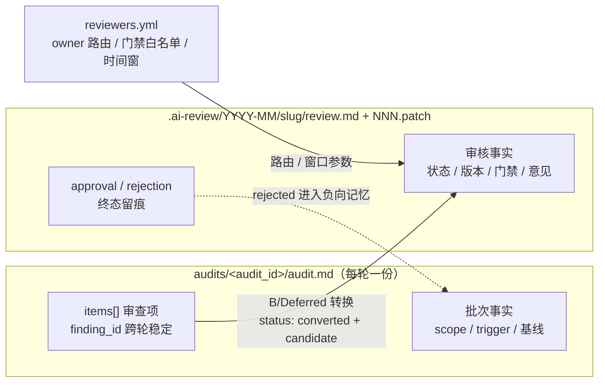
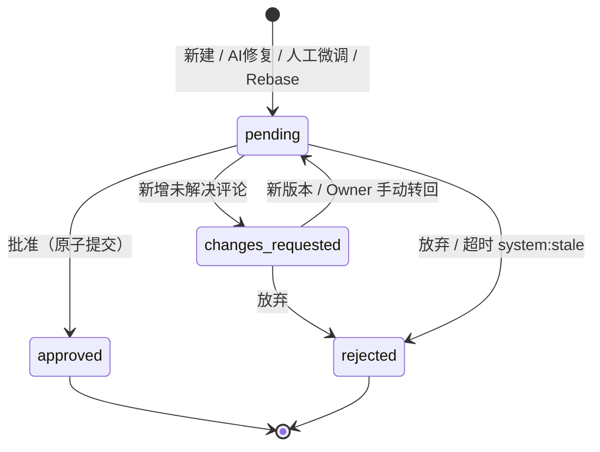
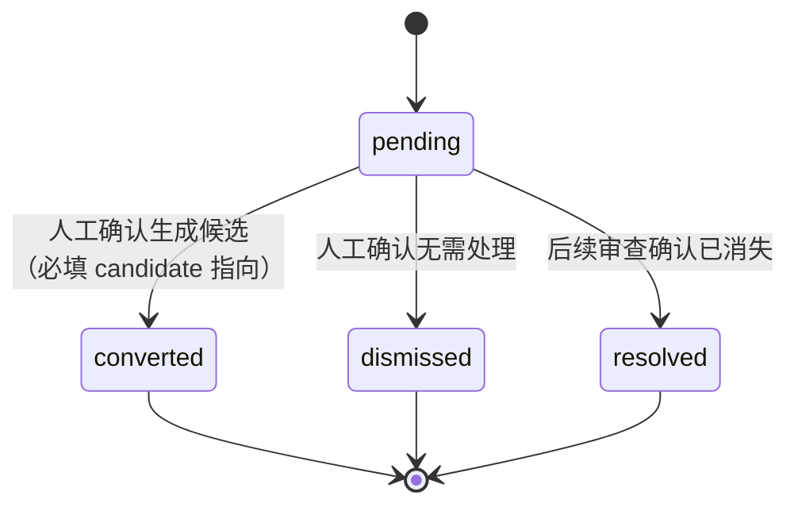
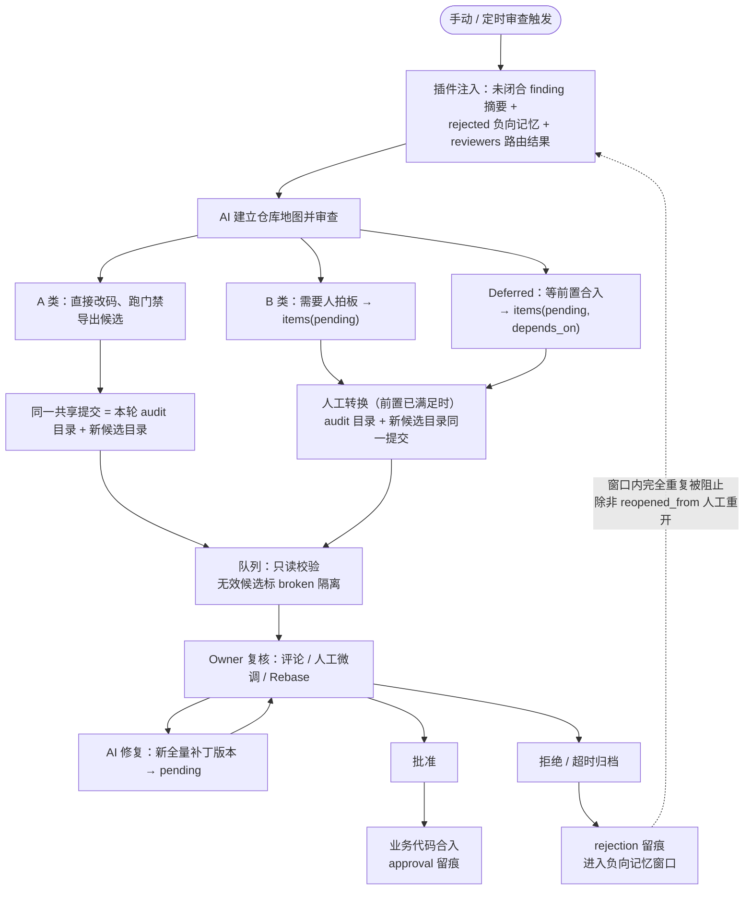
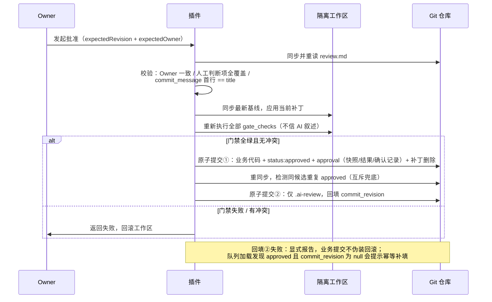
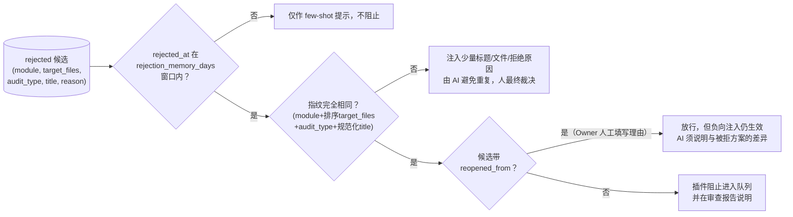

# DSH Review 工作流与数据契约 · 精读版

> 提炼自 [2026-11-03-review-workflow-data-design.md](2026-11-03-review-workflow-data-design.md)（commit `bda37f6`），面向人类阅读；两文冲突时以原设计文档为准。

## 0. 一句话

**仓库是唯一共享事实源**：AI 审查代码产生「审查档案」与「修复候选」，人类审核候选，批准原子合入、拒绝沉淀为负向记忆；插件不做后端、不建索引，一切从已提交的事实文件计算。

## 1. 三份共享数据

| 数据 | 回答的问题 | 关键字段 |
| --- | --- | --- |
| `audit.md` | 这轮审查看了什么、发现了什么、结论如何 | `audit_id`、`scope`、`items[].finding_id/status` |
| `review.md` | 这个修复包是谁的、改了什么、审到哪一步 | `status`、`revisions[]`、`gate_checks`、`approval/rejection` |
| `reviewers.yml` | 初始 owner 给谁、哪些命令免确认、多久超时/记多久 | `rules[]`、`allowed_gate_commands`、`stale_days`、`rejection_memory_days` |

身份规范：`finding_id = <module>-<slug>`（跨轮永久稳定）；`candidate_id = YYYY-MM/YYYYMMDD-<module>-<slug>`（创建后不可改名移动）。

## 2. 两台状态机

候选（`review.md.status`）——四态，终态不可逆：

- `changes_requested` 是流程标志，不是「存在未解决意见」的派生值（`pending` 也可带未解决意见）。
- AI 修复失败不写共享状态：候选停在 `changes_requested`，可重试或手动转回，不会死锁。

审查项（`audit.md items[].status`）——记录 B/Deferred 的工作结论，不随候选结果反写：

- `converted` 只表示「转过候选」；候选之后批准与否由 `review.md` 记录，下一轮用新的同 `finding_id` 条目给出新观察。
- 查询「当前还有哪些问题」用投影规则：取覆盖该 finding 的最新一轮观察；`converted` 的再结合候选真实状态（approved=闭合，rejected=重新开启）。

## 3. 端到端流程

审查会话模式（AI 直接提交）的约定：路由结果在会话启动时以提示词参数传入；无效候选由队列加载时的只读校验兜住（broken 隔离），不依赖会话内拦截。

## 4. 批准流水线（最严格的一条路径）

## 5. 拒绝、超时与负向记忆

拒绝在同一共享提交里完成：`rejection`（`rejected_by`/`rejected_at`/`reason` 非空）+ `status` + `updated_at` + 删除过程补丁。`review.md` 永久保留，作为负向记忆事实源。

超时不做「读时写」：队列加载只提示过期；实际归档由定时任务或显式「归档过期候选」操作执行，`rejected_by: system:stale`，乐观锁保证只写一次。

## 6. 读取口径：共享事实 vs 本地视图

队列、批准、负向记忆、投影、提示词注入**只使用共享事实**（已进入当前分支 HEAD 的 `.ai-review` 内容）。未提交的工作区改动是本地视图：可显示为 `local` 诊断项，但不参与任何裁决、不计 KPI。

| 环境 | 共享事实判定 | 本地视图判定 |
| --- | --- | --- |
| Git | 路径无 `git status` 改动且在 HEAD 中 | `git status --porcelain` 有条目 |
| SVN | `svn status --xml` 无任何本地改动条目 | 存在 modified/added/deleted/replaced/属性改动；unversioned 也算本地视图 |

SVN 增量 diff 无 worktree 可切换：无法干净应用时按 hunk 级降级（丢弃该 hunk 并显著提示），不阻塞整份读取。

## 7. 并发与流程保证

四条兜底，全部是流程级约定、无数据结构开销：

1. **并发批准互斥**：共享写操作经同一共享检出的检出级互斥串行化；批准提交后重同步，发现同候选重复 `approved` 显式报告、人工裁决（多克隆分布式并发不在本期范围）。
2. **乐观锁贯穿所有写**：`expectedRevision + expectedOwner`，失败即返回 409/400 并恢复文件，绝不以成功响应掩盖。
3. **broken 候选出口**：不参与任何流转；唯一恢复路径是 Owner 人工修复 + 一次仅含该候选目录的显式修复提交；不可修复者只读展示或人工补合法 `rejection` 退出；禁止 AI 自动改写。
4. **审查目录冲突**：审查完成提交前校验本轮 audit 目录及新候选目录不存在；同秒冲突即本轮失败重试。

## 8. 已决事项速览（原 §18，2026-11-04 全部落定）

| # | 事项 | 决定 |
| --- | --- | --- |
| 1 | 超时触发 | 禁止读时写；定时任务 / 显式归档操作执行 |
| 2 | 会话模式 owner 路由 | 提示词传入解析结果；会话后只读告警不自动改 |
| 3 | 会话模式校验 | 收口在队列加载（broken 隔离）；留 `POST /audit/verify` 给自动化 |
| 4 | `audit_type` 映射 | 扩展为 9 值：+`stdlib`/`native`/`yagni`（additive，schema_version 保持 1） |
| 5 | SVN 已提交判定 | `svn status --xml` 规则 + hunk 级降级（见 §6 表） |
| 6 | 负向记忆误判覆盖 | 可选字段 `reopened_from`/`reopen_reason`，仅 Owner 人工填写 |
| 7 | 批量操作与真实鉴权 | 一期不做（deferred）；owner 是本地约定不是鉴权 |
| 8 | 流程保证补全 | 并发批准互斥、回填恢复、broken 出口、目录冲突校验（见 §7） |

## 9. 明确不做的事（边界）

- 不建共享 `index.json`、不建独立数据库、不开发后端。
- 不引入 Stacked Patches、双向来源字段、逐版门禁快照（历史门禁查 Git）。
- 共享状态只有四值候选状态与四值审查项状态，冲突/执行中/验证中都是本地状态。
- 门禁以当前用户权限执行任意 shell 命令——白名单只降低确认成本，不是安全边界；只批准可信来源的候选。
- 默认只 commit 不 push；`owner` 不是鉴权，真正的权限需仓库/服务端能力。
