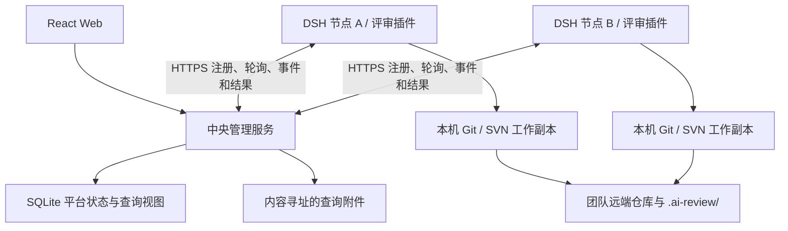

# 中央评审服务、多 DSH 节点与 Web 技术设计

> **任务来源**: 用户要求将现有评审插件演进为中心化 Web 平台，先讨论方案再实施；已认可交互原型及前端选型，并明确首期需要多台机器上的多个 DSH 实例接入。最新要求是先将设计文档落地，再继续讨论。
> **任务内容**: 定义中央管理服务、Web、DSH 执行插件的职责，确定项目绑定、查询同步、可靠指令、审核与远端交付的技术边界；供确认后制定实施计划。
> **参考文档**:
> - `AGENTS.md` — 独立 worktree、契约更新、审查和验证纪律。
> - `SPEC.md` — 当前权威契约；现有共享事实、门禁、不变量及恢复语义应保留，中心化扩展需在实施时同步修订。
> - `docs/plans/2026-11-16-central-web-discussion.md` — 本次对话的已确认选择、原型路径和延期需求。
> - `src/host/api.ts`、`src/host/api-context.ts`、`src/host/routes.ts` — 当前 API、请求上下文、路由互斥与仓库解析。
> - `src/host/jobs.ts`、`src/host/audit-lifecycle.ts` — 当前内存任务、取消信号与持久化审查租约。
> - `src/host/api-audit.ts`、`src/host/approval.ts`、`src/host/runner.ts`、`src/host/vcs.ts` — 当前审查、批准、进程执行和 Git/SVN 实现。
> - `src/client/client.ts` — 当前界面、评论锚点、并排差异和日志偏移协议。
> - `https://github.com/deepseek-ai/deepseek-harness/blob/master/docs/subsystems/web-server.md` — DSH 插件路由与访问校验；需与实际部署版本核对。
> - `https://github.com/deepseek-ai/deepseek-harness/blob/master/packages/bundle/web-app/README.md` — DSH Web 启动及部署。
> - `https://vite.dev/guide/build.html` — 前端构建及静态资源路径。
> - `https://reactrouter.com/start/declarative/routing` — 前端页面路由。
> - `https://tanstack.com/query/latest/docs/framework/react/overview` — 前端接口状态管理。
> - `https://nodejs.org/api/sqlite.html` — Node SQLite API；实施绑定实际 Node 24 运行时能力，不直接采用最新文档中的新增接口。
> - `https://git-scm.com/docs/git-push` — Git 交付、拒绝和非快进语义。
> **生成日期**: 2026-11-16

**状态：2026-11-16 用户已认可方案，进入实施。** 用户在完成中央服务职责及技术选型讲解后回复“ok,我赞同你的方案”。本文是本轮实施的已认可设计；产品契约仍须先同步更新 SPEC，不能用本文绕过现行不变量。

## 1. 目标、范围与已确认约束

### 1.1 用户已经确定

- 首期支持多台机器上的多个 DSH 实例，每个实例安装评审插件。
- Web 提供查看、评论、AI 修复、人工批准与提交的完整闭环。
- Git、SVN 均为首期能力。Git 直接推送目标分支，SVN 直接提交远端。
- `.ai-review/` 继续保存报告、候选、补丁、评论和审核状态，随业务仓库提交并同步远端。
- 优先建设 Web 展现和管理。原型的信息结构、前端技术方向已认可。
- 前端使用 React、TypeScript、Vite、React Router、TanStack Query、CSS Modules 与设计变量。
- 平台保持跨平台；项目工具链在节点接入时配置，操作系统不预先限定。

### 1.2 建议首期交付范围（待讨论确认）

- 独立中央管理服务及真实 Web 界面。
- 节点预置身份、注册、心跳、在线诊断和版本兼容检查。
- 项目管理与工作副本绑定；跨项目工作台、报告、候选和任务查询。
- 可靠下发审核操作，节点防重执行并可靠回报结果。
- 复用现有审核核心，补齐管理模式所需的项目隔离、执行恢复、Git 推送与交付状态。
- 基础登录身份和节点通信鉴权；复杂角色、项目级权限与企业 SSO 后排。
- 首期中央单实例部署，执行节点多实例部署。

### 1.3 延期范围

- “先对照修复复查上轮结果，再开始本轮全量审查”的自动编排与定时启用。本次不改成增量审查。
- 自动选择节点、故障后自动迁移项目、跨节点并行执行同一工作副本。
- 自动安装项目工具链、引擎、依赖或远程构建集群。
- 中央服务多副本高可用。

首期可从 Web 手动启动现有全量审查，不能把延期的历史复查编排展示为已经运行。

## 2. 比较过的方案与取舍

| 方案 | 优点 | 代价及适用边界 | 结论 |
| --- | --- | --- | --- |
| 前端直接连接单个 DSH 插件 | 最大化复用宿主，部署简单 | 多节点统一查询、注册和平台管理缺少独立归属；宿主离线影响全部访问 | 与首期多机器目标不匹配 |
| 轻量中转，转发 API 并缓存结果 | 改造较少，可聚合查询 | 项目、任务和恢复状态继续散落在各宿主；缓存不能解决重复下发和结果不明 | 不作为本次主方案 |
| 中央管理服务 + DSH 执行插件 | 平台统一管理，执行就近使用工作副本和工具链；能浏览离线节点已同步的结果 | 增加服务部署及可靠通信协议，需要明确最终一致性和恢复边界 | 本文建议采用，与用户多节点要求一致 |

## 3. 系统职责与技术选型

### 3.1 中央服务

建议使用 Node.js + TypeScript + Fastify，SQLite 使用 Node 内置 `node:sqlite`，不额外部署数据库服务。中央进程不执行 Agent、项目门禁或 VCS 写入。

- 管理用户基础身份、节点、项目和项目绑定。
- 持久化操作指令、任务事件、日志、交付诊断和查询缓存。
- 提供 Web REST API，并提供单独的节点协议 API。
- 提供构建后的前端静态资源，Web 默认同源访问中央 API。
- 约束同一项目只有一条未决写指令，供执行节点领取。

本机 Node 24.15.0 已实测可创建内置 SQLite 内存数据库。部署仍需对所选 Node/DSH 版本做能力检查。使用该版本实际提供的同步短查询与短事务，不在数据库事务内等待网络、Agent 或门禁。

### 3.2 DSH 插件

- 主动连接中央服务，维护节点身份和本机工作副本目录。
- 上报节点、项目快照、执行事件及结果；拉取分配给自己的指令。
- 执行时按实际工作副本重新读取共享事实、配置及全部并发 guard。
- 继续由现有审核核心负责租约、补丁、门禁、候选收尾及原子提交。
- 负责远端交付和结果核验，保存本地执行日志与未确认回报。

DSH 仍是首期执行宿主，现有 `external` Runner 可以继续作为节点的执行配置。暂不创建通用第三方 Agent 平台或新执行 SDK。

### 3.3 前端

按原型拆分应用框架、页面和领域组件，使用 TSX。接口状态归 TanStack Query，筛选及导航状态归 URL，评论草稿保留在当前审核上下文中。

- 页面：登录、审核工作台、项目管理、执行节点、审查报告、候选详情、任务记录、平台设置。
- 节点页面是支持多实例后新增的必要管理入口，沿用原型的布局和视觉变量。
- 差异展示、版本切换、行内评论和锚点继续遵守当前契约。
- 展示加载、空结果、解析错误、节点离线、数据过期、并发失配及恢复状态。
- 任务进度采用中央 API 增量轮询；日志偏移使用绝对序号，不因截断回退。

## 4. 身份、部署及访问边界

### 4.1 基础用户身份

新增中心后不能把 DSH 的宿主访问凭据当作用户账号分发。建议首期提供本地账号登录，账号由管理员通过中央 CLI 创建，Web 使用服务端会话 Cookie。HTTPS 部署时使用 Secure、HttpOnly、SameSite Cookie；写接口校验会话及 CSRF。

首期所有已启用账号均为受信协作者，具有平台管理入口；不在本次引入角色矩阵或项目可见范围。账号有不可变 `userId`、显示名及管理员配置的审核身份 `reviewIdentity`。`reviewIdentity` 用于兼容现有 reviewers.yml 与 owner 留痕，不由浏览器请求自行声明。中心指令携带经登录解析的操作者，节点只接受已认证中心下发的身份。

这是新增中心服务的工程建议，属于本次待确认内容。后续 RBAC 可收紧平台管理与项目操作范围。

### 4.2 节点身份

管理员先创建节点并产生高熵节点凭据，插件通过凭据引用获取秘密，再主动注册。注册不是匿名自动接纳：节点不得靠自报名称认领项目或扩大绑定。

中央只保存节点 Token 的摘要。各节点凭据相互独立，可吊销；节点只能领取自身绑定的指令、写入自身事件与已授权项目快照。前端不获取节点 Token 或 DSH 宿主启动 Token。

### 4.3 部署拓扑

首期一个中央服务进程、一个 SQLite 数据目录，任意多个执行节点通过 HTTPS 主动连接中心。节点无需向中心开放 DSH Web 的外部端口。

中央可先运行在选定的 Windows 或 Linux 主机上；节点按项目工具链部署。HTTP 仅用于本机开发，正式跨机器通信使用 HTTPS，可由现有反向代理终止 TLS。

协议有独立 `protocolVersion`，与插件版本、DSH 版本分别上报。不兼容节点只显示诊断，不能领取写指令。实施时验证实际 DSH 版本的插件加载、凭据服务和 Runner 调用，不把上游 master 文档当作本机兼容性证据。

## 5. 项目与工作副本模型

### 5.1 对象关系

- `nodeId`：一个已登记的 DSH 插件实例，不等于物理机器。注册同时上报本次启动的 `instanceId`。
- `workspaceId`：节点管理员配置的工作副本标识，映射真实本地根目录及允许的执行配置。
- `projectId`：中心的评审项目，绑定一个节点、一个 workspace 及一个目标分支或 SVN 路径。
- `bindingGeneration`：绑定变更的递增代数，阻止旧绑定指令被新配置错误接收。

一个节点可管理多个项目。首期每个项目只有一个执行节点，同一节点内禁止多个项目写入同一真实工作副本。节点以 realpath 规范化目录；Windows 路径比较和 POSIX 大小写语义分别处理。

### 5.2 接入项目的建议默认方式

首期由节点管理员准备 Git/SVN 工作副本及工具链，插件上报可接入的 workspace。Web 选择节点与 workspace，设置项目名称、负责人、目标位置及审核相关配置。

中心不向节点下发任意绝对路径或任意 shell；本地执行目录、凭据引用及可用 Runner 由节点配置决定。节点校验中心项目配置与本机仓库类型、目标位置和 workspace 允许范围一致。

项目配置具有 `projectConfigRevision`。绑定与执行配置变更在项目存在未决写指令时拒绝；节点先校验并确认应用新配置，再领取引用该配置版本的指令。单条执行使用固定配置快照，不因中心页面保存设置而中途更换 Runner、身份或目标分支。

这意味着原型中手填服务器路径的区域将调整为“选择节点 → 选择工作副本 → 展示仓库信息”。自动 clone/checkout 接入不是首期默认交付；如用户要求，应在实施前补入范围。

### 5.3 绑定与独占

中心使用数据库事务保证同一项目只有一条未决写指令。节点继续按真实工作副本使用现有 repo 锁和持久化审查租约；读请求不占项目写指令名额。

节点掉线不使项目绑定或执行占用自动失效。修改绑定前须处理未决任务，并确认旧执行器已停止；首期不自动故障转移。

平台不承诺阻止管理员在系统外用另一个工具手工改同一目录。现有清洁度、共享快照和提交内容核对仍须识别外部变化，拒绝夹带内容。

## 6. 数据归属和查询同步

### 6.1 权威边界

| 数据 | 权威来源 | 中心存储用途 |
| --- | --- | --- |
| 候选、补丁、评论、人工判断、报告、拒绝与批准记录 | 已提交的仓库 `.ai-review/` | 可重建的只读查询视图 |
| 项目、账号、节点、绑定、操作指令 | 中央 SQLite | 平台配置及受理事实 |
| 当前执行阶段、结果、工作区诊断 | 节点执行记录及 VCS 核验 | 任务展示、回报与恢复诊断 |
| Git/SVN 已交付结果 | 节点对目标远端及原提交的核验 | 展示已确认的交付状态 |

中心不直接改缓存中的评论或候选来完成操作。所有评审写入都由节点提交到仓库，再同步新快照。

### 6.2 同步协议

心跳只上报节点在线状态、容量、项目快照标识和当前任务摘要。候选、报告和补丁不塞入每次心跳。

节点按同一共享快照生成项目索引：队列、findings、报告列表及诊断。索引具有 `projectId`、`bindingGeneration`、明确的 VCS 快照、schema 版本、节点事件序号和采集时间。中心只在一批索引验证完整后原子切换该项目当前视图，不拼接不同快照的数据。

节点发现已提交快照变化、操作完成或管理员请求刷新时触发同步。可保留低频状态轮询以发现节点本地的外部提交；这不等于延期的定时审查。

### 6.3 详情与附件

候选详情、补丁、报告正文、版本差异按输入快照与查询参数缓存。中心已有准确版本时直接返回；未缓存且节点在线时创建可重试的只读查询请求，由该节点调用现有读模型并上报结果。

首次未命中返回 `202`、查询标识与轮询地址，Web 显示加载状态。节点离线时，有缓存则返回缓存并标注离线及同步时间；没有缓存则明确返回不可用，不伪装成候选不存在。

大型内容使用按 SHA-256 寻址的附件文件，SQLite 保存清单和摘要。中心先校验长度及摘要、原子落盘，再提交索引引用；附件路径由摘要生成，不使用客户端提供的文件路径。补丁字节不进行换行或编码规范化。

缓存键包括项目、绑定代数、VCS 快照、schema 版本、资源标识与查询参数。旧节点回报、旧绑定和乱序快照不能覆盖新的当前视图。

每项目的 `snapshotSequence` 在节点持久化，重启后继续递增。中心以绑定代数与该序号排序，不用采集时间排序。按指定快照查询详情时，节点必须回报实际读取的快照；若已无法提供请求版本，返回 `snapshot_moved` 并触发索引刷新，不能把当前 HEAD 内容存进旧版本缓存键。

### 6.4 新鲜度与写入依据

每个读响应给出数据版本、同步时间、节点在线状态和新鲜度。界面上“节点在线”与“项目数据已同步”分开显示。

浏览器提交操作时带当前视图对应的 guard。节点执行前在锁内重新读取真实共享快照并验证 guard、owner、状态、判断项与配置。缓存不能作为批准证据。离线或节点仍在恢复的项目首期只读，不排队接收新的业务写操作。

202 不触发对评审事实的乐观覆盖。Web 可以显示“意见提交中”等临时进度；评论和候选最终状态在节点提交、结果核验并同步新视图后更新。guard 失配保留草稿供用户核对，同时阻止沿旧版本继续批准。

## 7. 指令与任务协议

### 7.1 指令信封

每条写指令至少包含：`commandId`、`requestHash`、`projectId`、`nodeId`、`bindingGeneration`、`projectConfigRevision`、受信操作者、操作类型、业务参数、并发 guard 和创建时间。

同一客户端操作使用稳定幂等键。中心对同项目幂等键重复请求返回原指令；同一键但参数不同返回冲突。

操作使用固定枚举及各自的输入 schema，包含现有评论、接管、拒绝、批准、AI 修复、Rebase、审查启动/收尾/释放、finding 处理及同步。不存在允许浏览器下发任意命令的通用执行接口。

### 7.2 生命周期

中心分别保存指令状态、执行结果和交付结果，不合并成一个 succeeded：

- 指令：`queued → dispatched → accepted → executing → completed`。
- 未确认或崩溃：`recovery_required`，占用项目写名额。
- 取消：记录 `cancel_requested`；只有节点核验后才能得到最终结果。
- 业务结果保留现有 `ApprovalOutcome`、`AiFixOutcome` 等判别联合，不混用其原因枚举。
- 远端交付单独记录 `not_required / pending / delivered / conflict / unknown`。

中心先持久化指令与项目占用，再允许节点领取。节点领取后先持久化本地受理记录，再 ACK，再执行；相同 commandId 的重复投递返回已保存的记录或结果，不创建第二次执行。

节点初始上报一个执行槽位，同一节点的写执行默认串行，不同节点可以并行。查询同步不必等待 Agent 执行结束；工作副本内的读操作仍绑定稳定快照。

取消与恢复控制不作为一条新的普通项目写指令去抢占已经被原任务持有的名额。节点即使执行槽位已满，也必须继续轮询心跳、取消控制和结果 ACK。取消绑定原 commandId，最终业务结果仍由执行器停止及 VCS 核验确定。

### 7.3 事件、日志和回报

节点事件具有 commandId 和单调递增序号；中心按唯一键去重，ACK 最高连续序号。节点保留未确认终态及回报，断线后重传。乱序结果不反向覆盖终态。

日志使用绝对偏移及截断标识，沿用现有每任务 4000 行的有界窗口；需要重置时显式返回日志快照。首期不自动删除任务元数据。完整历史日志和附件回收策略留待后续明确，不暗中无限保留执行输出。

### 7.4 心跳与重启

建议默认心跳 10 秒，连续 30 秒无心跳标记离线。节点轮询指令采用短轮询和失败退避。时间只用于在线诊断，不用于推断提交是否存在。

相同 nodeId 的活动 instanceId 冲突时拒绝并显示诊断。重新启动须先回报本地未决执行记录，与中心核对后再领取新写指令。

中心重启从 SQLite 恢复未决指令和占用，不把派发超时等同于执行失败。节点重启对 accepted/executing 记录先核验本地租约、工作区和 VCS；已提交则返回原结果，无法确定则进入恢复状态，不重新执行同一副作用。

尚未开始且可证明无副作用的指令可以继续执行或取消。执行阶段无法证明安全时，由人处理现场后发起明确的恢复确认；恢复确认也要由节点核验，不能直接清空中心占用。

### 7.5 当前代码需要的接缝

提取可由 HTTP 和中心指令共同调用的类型化业务入口；不在中心复制审核逻辑，也不通过插件公开 HTTP 接口伪造认证请求来执行内部操作。

节点托管模式通过受信执行上下文解析当前操作者，不把每条请求的身份写进全局 settings.owner，防止并发身份串扰。项目设置按实例或明确 runtime 作用域解析，共享真实工作副本的锁与生命周期。

在受理及执行关键副作用前落盘指令阶段、VCS 探针和恢复所需输入。执行日志必须在内存 Job 淘汰之前同步到持久化记录，不能仅靠 JobManager 的 Map 去防重或恢复。

## 8. 审查、修复与交付

### 8.1 执行模式

托管模式下 Web 手动审查与 AI 修复优先走现有进程型 Runner：进程结束后由插件验证、收尾并提交 `.ai-review/`，便于任务闭环及取消。DSH 会话模式继续作为本地能力；首期中心流程不依赖尚未验收的真实 turn 自动结束钩子。

Runner 的实际 CLI 参数及结束语义必须按部署版本验证。Agent 不负责业务批准或直接推送；这些由插件校验并执行。

### 8.2 每次共享写的远端交付

不仅批准，评论、接管、拒绝、候选收尾等共享写也须提交并同步 `.ai-review/`。

Git 在原子提交成功后保存原提交标识并推送目标分支，只有核验远端包含该提交后才标记 delivered。推送超时先查询远端，再决定是否重试原提交。目标分支发生分叉时记录 conflict，首期保留现场进入人工恢复，不自动强推、合并或重写已批准提交。

SVN commit 已执行远端交付。异常时沿用 VCS 探针与提交内容核对的“存在 / 证明不存在 / 不明”处理，不能因中心未收到回报而重复提交。

本地提交已成功但交付待处理或未知时，项目保持写阻塞；查询仍可显示已提交的本地事实，同时明确远端交付尚未确认。业务回滚必须满足原契约中“已证明提交不存在”等条件，不能因推送失败撤销已提交事实。

### 8.3 批准的含义

审核批准与远端交付是两个维度。候选可以在本地 VCS 中已经 approved，而中心任务仍等待远端确认。Web 的完成提示必须同时呈现两者；不能重复触发批准来解决推送失败。

## 9. API、存储与仓库布局建议

### 9.1 API 分区

- 用户 API：`/api/v1/auth`、`/projects`、`/nodes`、`/workbench`、`/projects/:id/...`、`/commands/:id`、`/tasks/:id/logs`。
- 节点 API：`/node-api/v1/register`、`/heartbeat`、`/commands/poll`、`/commands/:id/ack`、`/events`、`/snapshots`、`/queries`、`/artifacts`。
- API 使用同一共享协议包定义类型和运行时 schema；用户 API 与节点 API 分别鉴权。
- 202 只表示已受理或查询准备中，界面继续读取任务业务结果。
- 409 表示版本/状态/占用冲突；节点离线和没有缓存与 404 资源不存在分别表达。

以上是路由分区，不要求一开始为每个列表增设一套重复 API；具体路径、分页及 schema 由实施计划确定，并同步登记到 SPEC。

### 9.2 数据位置

- 中央数据目录：SQLite、只读查询附件和备份；不位于被审业务仓库。
- 节点数据目录：现有 DSH_HOME 下的节点配置、每项目执行记录、租约和未确认回报；不同 workspace 不共享可写审查数据。
- 业务仓库：现有 `.ai-review/`，保持格式与共享事实约束。

中心 SQLite 的主要对象为 users/sessions、nodes、projects/bindings、commands/tasks/events、project_snapshots 和 artifact_manifests。禁止为提升界面响应速度而建立可独立编辑的第二套 review/finding 事实表。

### 9.3 源码组织

建议保持本仓库，以 npm workspaces 管理三个新增边界：`apps/web`、`apps/server`、`packages/protocol`。现有 `src/host` 保留为 DSH 插件及审核核心，只增加托管模式接线与必要的类型化入口。

原 `dist` 插件导出与旧测试保留。前端构建、中心服务构建与插件构建分别有命令，根验证命令覆盖全部。依赖版本在实施时按实际 Node 与 DSH 兼容性锁定到 lockfile，不自动升级宿主。

原 DSH 评审标签的建议处理：本地模式继续保留现有页面；显式接入中心的托管模式将标签变为中央工作台入口，不维护第二套完整托管 UI。托管模式的仓库写操作统一经中心指令，同一工作副本不同时运行独立本地写入口。

## 10. 契约演进、实施顺序与验收

### 10.1 契约更新

实施首先修订 SPEC 中的产品边界、非目标、HTTP API、设置、身份、Job 持久化、Git 推送和多节点语义；新增稳定 AC/I 标识，保留已有关键不变量。不把本设计或 README 当作绕过当前 SPEC 的依据。

现有纯本地模式的测试继续成立；托管扩展采用显式模式与新契约，不能靠放宽原断言通过。

### 10.2 实施顺序

1. 协议与 SPEC：定义节点、项目绑定、查询版本、可靠指令及交付状态。
2. 中央与节点最小纵向闭环：两个独立节点注册、绑定各自 workspace、同步真实查询结果，在 Web 展示多项目。
3. 可靠写链路：持久化、防重、断线重连、取消、项目互斥与恢复核验。
4. 接入现有审核动作及 Git/SVN 交付，实现完整真实审核详情与任务管理。
5. 完成 Web 其余管理页面、基础登录和部署文档，并进行独立审查与验收。

阶段仅表示依赖顺序，不允许在基础鉴权或恢复保护尚未具备时向真实跨机器环境开放写接口。具体任务在本文获批后另写实施计划。

### 10.3 关键验收

- 两个独立节点、多个项目同时在线，指令、结果和缓存不串项目、不串节点。
- 未登记、被吊销、旧绑定和不兼容节点不能领取写指令。
- 同一指令重复投递、ACK 丢失、终态回报丢失，不重复执行审核副作用。
- 中央与节点分别重启后，占用及未决结果仍可核验；掉线不触发自动接管或重跑。
- 旧快照、旧 guard、乱序同步和缓存滞后不能误批准或覆盖新数据。
- Git 推送失败、响应丢失、远端分叉分别可复现；SVN 提交结果不明也按原语义处理。
- `.ai-review/` 本地草稿、broken 和未复算门禁的展示继续准确。
- 浏览器覆盖列表、报告、差异、评论、修复、判断项、批准、任务日志及离线只读。
- `npm run typecheck`、`npm run build`、现有全量 Node 测试，以及新增中心/节点协议与浏览器关键行为检查通过；原测试数量不减少、断言不放宽。

自动化集成至少运行两个隔离节点数据目录和工作副本，覆盖 Git 及真实 SVN 夹具。模拟执行器验证协议不能冒充真实 DSH 或真实跨机器验收；可用环境不足的部分必须单独列为部署验收项，报告实际验证范围。

## 11. 待用户确认的工程默认值

以下不是用户此前逐项拍板的要求，而是本设计作出的建议：

1. 中央服务使用 Node.js/TypeScript/Fastify，SQLite 单实例；节点使用 HTTPS 主动注册、心跳和 HTTP 拉取。
2. 首期接入节点上预先准备的工作副本，不在 Web 自动 clone/checkout 或安装工具链。
3. 首期提供基础本地账号登录，受信协作者权限一致，复杂角色与项目权限后排。
4. 首期项目固定绑定节点，掉线不自动迁移；托管模式的旧标签仅作为中央 Web 入口。

首批真实部署规模、实际 DSH 版本、中心与节点的部署机器及凭据，由实施计划的环境核对确定。若其中任何条件会改变上述技术边界，应先更新方案，不能默默替换目标。

## 12. 设计复核记录

2026-11-16 已完成作者自审，补充项目配置版本与执行快照、跨重启快照序号、详情版本漂移、202 展示语义和满槽时的取消控制。

随后由独立工程代理只读进行可实施性复核，要求仅报告会阻碍正确规划实现的重要未决问题，并逐条核对文档及代码。复核结论为“没有重要遗留问题”。该结论只覆盖设计可实施性，不表示产品代码、真实 DSH 多机部署或安全能力已经实现或通过验收。
